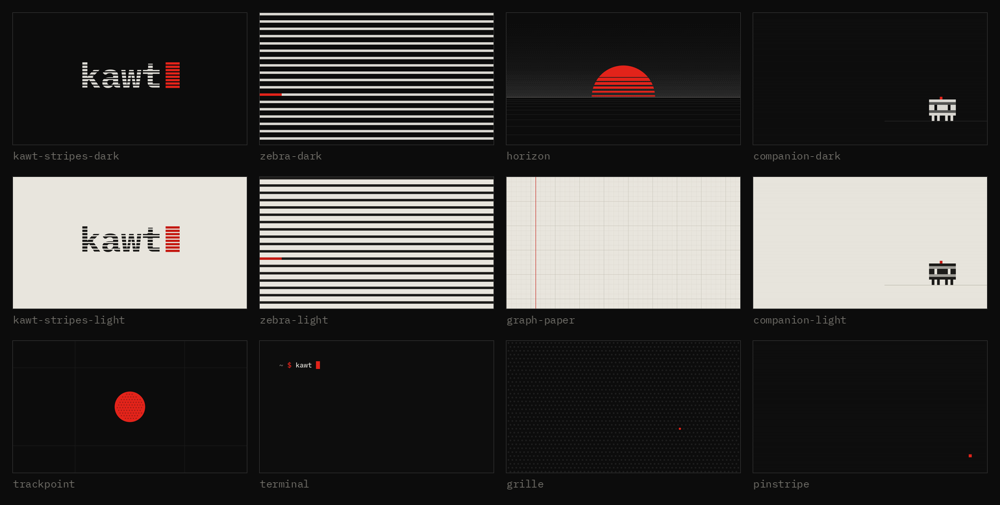
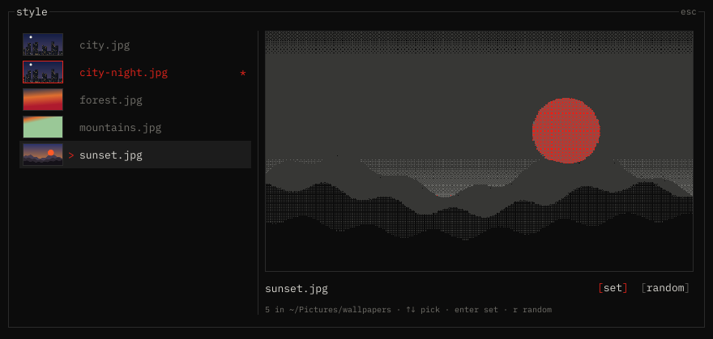
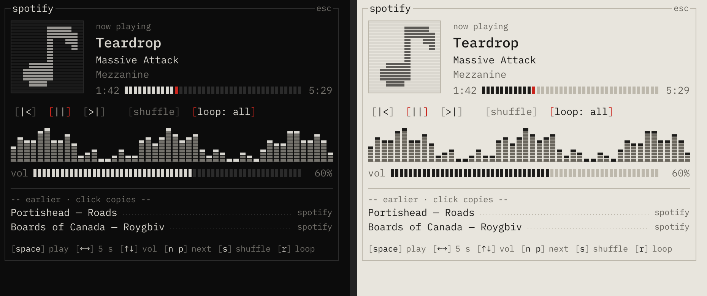
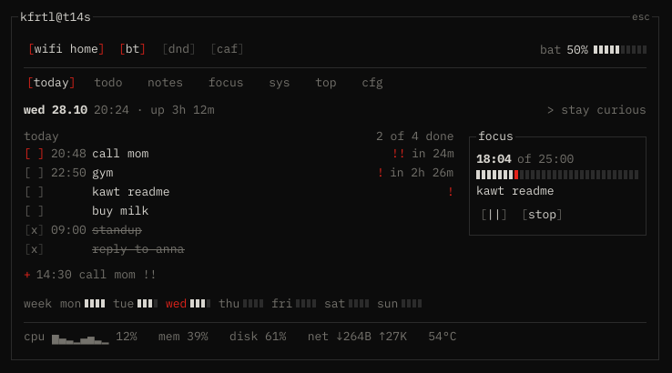
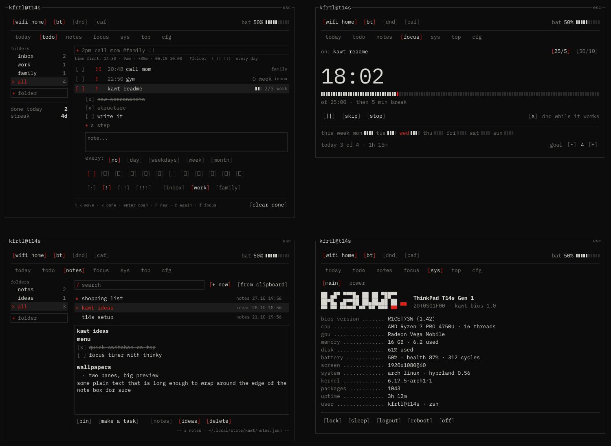
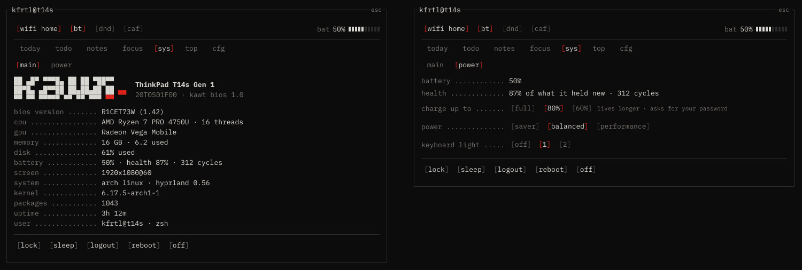
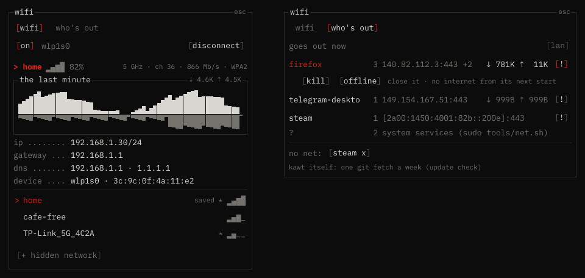
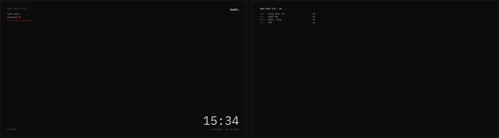

<div align="center">


A [Quickshell](https://quickshell.org) desktop shell for Hyprland, plus matching configs,<br>
all in one monospace, square-cornered, text-first style.<br>
<sub>a black ThinkPad and its one red light · IBM Plex Mono · old picture tubes · <code>[brackets]</code> around what you can press</sub>

[](#install)
[](https://hypr.land)
[](https://quickshell.org)
[](#install)
[](https://ollama.com)
[](LICENSE)

**[install](#install)** · [look](#look) · [the menu](#the-menu) · [network](#network) · [lock](#lock-and-boot) · [ai](#ai) · [the companion](#the-companion) · [what's inside](#whats-inside) · [keys](#keys)

</div>

## Look


One rule for everything: `[ ]` mean you can press it. The brackets are a step dimmer than the
words, red around what's chosen or open, darker around what's off; plain words are something to
read. Red is the only light, like the dot on a ThinkPad's lid: where you are, what's chosen, a
warning. Without brackets (profile → cfg → look → brackets off) the chosen ones turn red instead.

Three themes, picked in `super + w`: **black** and **white** (kawt's own: a black ThinkPad, or
paper and ink) and **wallpaper** (the same greys, lit in your wallpaper's own color instead of
red). Everything follows: GTK apps and Thunar, kitty and other terminals, Hyprland's borders,
fastfetch, the prompt, the folder icons.

Twelve wallpapers of its own come with it, in the same tones: kawt in stripes, black and white
bars, the companion, the trackpoint, a sunset, an old prompt, graph paper. The installer puts
them in `~/Pictures/wallpapers/kawt` (a link into the repo: a `git pull` brings new ones;
delete it and it stays gone) and asks which one to start with, or none if you have your own.

<p align="center">

</p>

<div align="center">
<br>
<sub><code>super + w</code>: the folder on the left, the picked one big on the right, as it will look</sub><br><br>
<br>
<sub>any wallpaper in the theme's few tones, dithered like an old screen; its reds stay as red dots</sub><br><br>
<br>
<sub>the player, dark and light</sub>
</div>

## The menu

`[●]` in the bar (or `super + i`, full screen) is where your day is.

<p align="center">

</p>

- **switches** on top, a click each: wifi, bluetooth, do not disturb, night light, caffeine,
  the mic; the battery on the right
- **today**: the day in one look. Tasks due today or before, then the ones without a time, the
  ones ticked off today struck through (`2 of 5 done`); the focus timer beside them; the week's
  rounds; the machine in one line
- **todo**: folders, importance, reminders, notes inside a task, **steps** with a `▮▮▯ 2/3`
  progress, tasks that **come again** (every day, weekdays, week, month: type `every day`),
  done today and the streak; a ticked one is struck through and slides down. Keys: `j k` move,
  `x` done, `enter` open, `n` new, `r` how often, `f` focus on it
- **focus**: a pomodoro (25/5 or 50/10) on a task or on nothing in particular; do not disturb
  while it works, the companion sits quietly, a notification at the end; rounds per day and a
  goal; it carries on over a restart (`kawt focus` from a key or a script)
- **notes**: in folders, with search; a note is read first (`# headings`, `- [ ]` boxes that
  tick with a click), a click writes in it; pinned ones on top; a note from the clipboard, or
  a task from a note
- **sys**: the machine like a ThinkPad's bios setup, and its **power** page (below)
- **top**: cpu and memory over the last minute and the busiest processes (a click twice: kill)
- **cfg**: everything else, in pages: look, screen, media, device, windows, kawt

<p align="center">

</p>

<p align="center">
<br>
<sub>sys → power: where the battery stops charging (full / 80% / 60%), the power profile, the keyboard light; each only where the machine has it</sub>
</p>

## Network

<p align="center">

</p>

The wifi panel shows the connection in use (band, channel, speed, security), the last minute
big (what comes in up from the line, what goes out down), ip, gateway, dns. A network without a
password says `open`. Its second page, **who's out**, lists every program talking to the
internet right now, with its connections and speed; `[!]` on one: `[kill]`, or `[offline]`:
started from the launcher or the dock it gets no internet from then on (its own empty network,
no root; `ctrl + o` in the launcher does the same). It's looked at only while the page is open.

kawt itself stays quiet: one `git fetch` a week to know about updates (off in profile → cfg →
kawt), nothing else unless you ask (the ai on an api you picked, `ollama pull`).

## Lock and boot

<p align="center">

</p>

The lock is a text console at its login, switched on like an old picture tube and off again
into a line and a dot. Once per login a bios-like check list runs (`kawt bios 1.0 ·` your
machine), then the desktop opens from a bright line. Both can be switched off (profile → cfg →
look).

## AI

<table>
<tr>
<td width="34%" valign="top">
<br>
<sub><code>[&gt;_]</code> a local model: nothing leaves the machine</sub>
</td>
<td valign="top">

`super + a`: chat with a local [ollama](https://ollama.com) model (or any OpenAI-compatible
api), saved chats, markdown answers with code to copy, compare two models; models installed,
pulled and unloaded from the panel, with limits so it doesn't eat the machine.

- `?question` in the launcher, `$what you want` for one shell command (it never runs by
  itself), `super + alt + a` on the text you marked in any window
- a screenshot's `[ask]` brings the picture to a model that sees
- `[x] tasks` gives it your todo list ("what's on tomorrow?")
- `super + alt + v`: speak, `whisper-cpp` writes it down on this machine
- **coder**: an agent in one project folder; every change is a diff to `[apply]`, `[undo]`
  takes all back, commands only in a sandbox with no network

</td>
</tr>
</table>

## The companion

<p align="center">

</p>

`[⌂]` in the bar is the house of a little pixel friend, plain like Claude Code's: **stripes**
(kawt's stripes, in your theme's ink; the one you meet first), **thinky** (a little black
ThinkPad with its red dot), **nub** (the red trackpoint), **ghost** (pale, a bit see-through),
**theme** (two horns, in your theme's colors), or your own (`~/.config/kawt/companions.json`,
the format is in `utils/companions.js`). He gets hungry, bored and sleepy with time: feed him,
play, put him to bed; left alone too long he sulks (he never dies).

<table>
<tr>
<td valign="top">
<br>
<sub>the first start: he shows you around (english or russian)</sub>
</td>
<td width="42%" valign="top">
<br>
<sub>his house: feed him, play, put him to bed</sub>
</td>
</tr>
</table>

Out on an empty desktop he walks about, dances to music, naps (a window opens and he goes home;
drag him along the edge, click him to talk, double click: home for an hour). He peeks out of the
corner when the battery gets low, the charger comes, a screenshot is taken, the recording
starts, a reminder rings, a new kawt is out (lvl up); never over a fullscreen window or in do
not disturb. Next to the coder he thinks, types, raises a flag on a diff, sweeps up after
`[undo]`. He keeps the focus timer with you. Off in profile → cfg → kawt: nothing runs for him.

<p align="center">

</p>

<p align="center">
<br>
<sub>thunar's folders, drawn by kawt in the theme you're on</sub>
</p>

## Install

```sh
git clone https://github.com/kfrttlw/kawt-shell ~/kawt
cd ~/kawt
./install.sh
```

```
-- what should go on this machine? --
 > everything       shell, terminal, prompt, fastfetch, thunar and the extras
   only the shell   the bar and panels + hyprland binds, nothing else
   let me pick      part by part
```

A menu asks which system this is (it guesses: Arch-based or not) and what to install
(arrows, space, enter). Then it shows the plan, and after a yes it does it; on a first start
the companion says hello. It never runs as root (it asks for sudo itself, only for pacman),
and running it again is safe. `./install.sh --fresh` starts over as on a new machine (all of
kawt's setup to a backup, every question again). More below:
[what the installer does](#what-the-installer-does).

Works on a laptop and a desktop alike: what a machine doesn't have (a battery, a backlight,
charge thresholds, a keyboard light) simply doesn't show.

## What's inside

**bar**: `[●] [$] 1 [2] 3 │ window title · [⌂] [wifi] [↓ ▁▃▅▇] [12:34] [> ▂▅▃] · [tray 3 v] [us] │ [bt] [mic] [vol ▮▮▮▯▯ 40] [br ▮▮▮▮▯ 60] [bat 72%] │ [log 2] [>_]`
(the wheel on the workspaces walks them, and with several monitors each bar lists its own; `[eth]` instead of `[wifi]` on a cable, `[vpn]` while a tunnel is up; `[cast ● app]` while something captures the screen or the webcam, `[caf on]` while caffeine is on)

| | |
|---|---|
| `[●]` menu | switches, today, todo, notes, focus, sys, top, cfg: [above](#the-menu) |
| `[$]` dock | pinned apps |
| launcher | rofi-like, with modes: apps · `!` run · `>` in terminal · `=` calculator · `?` ask the ai · `$` a command from the ai · `:` clipboard history · `;` open windows · `.` emoji; typed in the wrong layout, it still finds it (`ашкуащч` → firefox). An app's own actions by name (`private` → Firefox: New Private Window); `ctrl + s` pins, `ctrl + o` starts an app without internet from then on. With `qalc` the calculator does units, currencies and dates (`=10 km to mi`, `=today + 3 weeks`; exchange rates only the ones qalc has: kawt never makes it go online) |
| `[>_]` ai | [above](#ai) |
| `[log]` | notification daemon, `dmesg`-style history, do-not-disturb; keeps what the app asks for (`notify-send -t`, `-e` transient, replace tags) |
| wifi | [above](#network): the connection, the last minute, ip / gateway / dns, `open` networks marked, hidden networks; who's out, `[kill]` and `[offline]` |
| style | `super + w`: the wallpapers in two panes, dithered into the theme's tones (or as they are); black, white and wallpaper themes, dark or light (`super + shift + w`); your own in `~/.config/kawt/themes.json`. With awww kawt starts its daemon itself; a new wallpaper by itself every 15 min … 3 h if you like, with a transition (`crt`: drawn in from the top like an old screen's beam) |
| theme export | a theme switch recolors open terminals and GTK apps live and rewrites colors for kitty, Hyprland borders, GTK, foot, alacritty, shell scripts and kawt's folder icons; terminal colors as `crt`, `soft` or `vivid` |
| coder | an agent in one project folder: lists, searches, reads; every change a diff to `[apply]` or `[skip]`; `[undo]` puts everything back; commands (with `bubblewrap`) only after `[run]`, in a sandbox without network, the project the only writable place |
| windows | profile → cfg → windows: pick an app and it floats at its own size in the middle from then on |
| companion | [above](#the-companion) |
| lock | [above](#lock-and-boot). It locks before the machine sleeps, on `loginctl lock-session` and after 10 idle minutes (the backlight dims 30 s before); a minute later the picture goes off (only the picture: wifi, music and downloads go on). `[caps lock is on]` when it is. `kawt lockTest` tries it safely. No hypridle / hyprlock needed |
| osd | volume / brightness pop up; the charger in or out shows the battery; low battery at 20 / 10 / 5% |
| bluetooth | `[bt airpods 80%]`: on/off, scan, pair, connect, forget, headphone battery |
| mic | `[mic ● discord]` while an app records you (red), click to mute |
| player | `[> ▂▅▃▇▂]` next to the clock (real sound with `cava`); click: the cover in big pixels, a level-meter spectrum, `[|<] [||] [>|]`, the position as segments, shuffle, loop, the player's own volume, tabs when several play, this session's tracks |
| screenshots | area / window / screen, the screen still while you pick; a preview asks `[copy]` `[save]` `[open]` `[edit]` (`satty`) `[text]` (`tesseract`) `[ask]` (the ai) |
| recording | `[● rec 0:42]`; area or screen; sound: off, the mic, what you hear, or both |
| fastfetch | your system's logo in the theme's colors, or kawt in blocks, the trackpoint, kawt in stripes; nothing that says who or where you are, safe to screenshot |
| prompt | zsh: the folder inverted like a bios's chosen line, the git branch on grey, a failed command's code on red, `>` in red where you type; hints from history, typos marked |
| boot screen | once per login: `kawt bios 1.0 ·` your machine, cpu mem disk (bat) `ok`, then the desktop opens from a line; any key skips |
| old machine | profile → cfg → look: no blur, shadows or animations, graphs half as often, no visualizer (a T60, an X200); `scanlines` for faint tube lines |
| also | night light (`hyprsunset`), volume per app, brightness (on a desktop the monitors' own, over DDC/CI), calendar, tray, keyboard layout (one per window if you like), the bar at the top or the bottom or tucked away (`super + shift + b`) |

## What the installer does

<details>
<summary><b>step by step</b> (after the plan and your yes; what it replaces goes to a backup)</summary>

- installs what's missing with `pacman` (one `sudo pacman -Syu --needed ...`: the system is
  updated in the same go, Arch doesn't like half-updated systems; you can switch that off).
  Quickshell comes from the AUR if the repos don't have it: with `paru` or `yay` if you have
  one, otherwise built right there with `makepkg` (no helper needed). `pacman -Syu` never
  updates AUR packages: run `./install.sh` again now and then and it updates quickshell when
  the AUR has a newer one, and builds it again after a Qt update (`./doctor.sh` tells you
  when either is due). With paru / yay, their `-Syu` does the same
- symlinks the configs, so `git pull` updates everything in place. Configs that are already
  there are replaced but kept in `~/.local/state/kawt/backups/<date>/`
- gives your `hyprland.lua` one line that loads `hypr/kawt.lua` (wrapped in `pcall`, so a
  broken kawt can never take Hyprland down). Your own config stays yours, unless you pick
  **kawt's standard config**: CRT-style animations (windows open out of a line, no bouncing),
  square windows, small tools and dialogs floating at their own size instead of stretched,
  `super + v` floating ↔ tiled at 900x600 in the middle, a window mode on `super + z` (arrows
  resize, `shift` + arrows move, `f` float, `c` center, `p` pin), resize on
  `super + ctrl + arrows`, media keys through kawt's osd. Then `hyprland.lua` is three lines:

  ```lua
  dofile(".../kawt-shell/hypr/preset.lua")         -- the standard config: git pull updates it
  pcall(dofile, ".../kawt-shell/hypr/kawt.lua")    -- kawt's keys and theme colors
  dofile("~/.config/hypr/user.lua")                -- yours, last: it wins
  ```

  and everything of your own goes to `~/.config/hypr/user.lua` (made once, never replaced):
  monitors, layouts, mouse speed, `preset.terminal = "foot"` (and `files`, `browser`), any
  setting again (the last one counts). A key bound twice does both, so free a standard one
  first: `preset.unbind("SUPER + B")`, then bind yours. Each part of the standard config runs
  in its own `pcall`: one that doesn't fit your Hyprland version is skipped, not the rest.
  Your old `hyprland.lua` goes to the backup (`user.lua` says where); `--uninstall` puts it
  back, or, with none, copies the standard config into `hyprland.lua` so it works without
  kawt. Never started Hyprland yet, so there's none: the standard config is the default, or
  Hyprland's own (`/usr/share/hypr/hyprland.lua`, what Hyprland would write itself) without
  the two binds kawt uses (`super + r`, `super + shift + s`). Either way it asks which
  keyboard layouts you want next to `us` (`alt + shift` switches; it offers the ones of your
  old config, or guesses from your language, `ru_RU` -> `ru`), and about the monitors: auto
  (each at its own best mode, side by side) or by hand, each one by its name: its mode and
  refresh rate from the ones it has (or typed, `2560x1080@75`, `highrr`), or off; then its
  position (`0x0`, `auto-right`...), scale and turning. From a console it knows the sizes
  only; inside Hyprland the refresh rates too. Again any time: `./install.sh --monitors`, or `./install.sh` once more (with a config already there it asks whether to set them again)
  (the rules go into a block of their own in `user.lua`, a field a line like the catch-all in
  `hypr/preset.lua`, or the end of your `hyprland.lua` / `hyprland.conf`; inside Hyprland it's
  read at once and each monitor checked: one that didn't get the mode asked for is said; auto
  takes the block out)
- the first wallpaper, on a new install: kawt in stripes, the sunset, the companion, the bars,
  or none (picked first when hyprpaper, swaybg or the like still draws yours). kawt puts it on
  when it starts; another one any time in `super + w`
- an NVIDIA card: offers Hyprland's environment for it (`hypr/nvidia.lua`: video decoding on
  the gpu, OpenGL through nvidia; not on a hybrid laptop, where the intel / amd gpu draws) and,
  if there's no driver yet, the driver: `nvidia-open-dkms` for Turing and newer (GTX 16xx,
  RTX), `nvidia-580xx-dkms` from the AUR for GTX 9xx / 10xx (with paru or yay), with the
  kernel headers, `libva-nvidia-driver`, `lib32-nvidia-utils` when multilib is on and
  `nvidia-prime` (`prime-run`) on a hybrid. Older cards: by hand. A reboot after
- also installs what a fresh Hyprland lacks: sound for browsers and Discord (`pipewire-pulse`),
  screen sharing and "open file" windows (`xdg-desktop-portal-hyprland`, `-gtk`), the password
  window for apps that need admin rights (`hyprpolkitagent`, started by kawt), the play / pause
  keys (`playerctl`) and emoji (`noto-fonts-emoji`). Still on pulseaudio, or another polkit
  agent: those are left alone
- no login screen (display manager) on the machine: asks how Hyprland should start after you
  log in on the console: by itself on tty1 (a line in `~/.zprofile`), with a `start` command
  (in `~/.zshrc`; a `start` of your own is kept), or neither (not asked again). Both go
  through `hypr/login.sh`: `uwsm` if you have it, otherwise `start-hyprland`
- installs zsh (with `zsh-autosuggestions` and `zsh-syntax-highlighting`, the history hints and
  the typo marks) and adds one line to the end of your `~/.zshrc` that loads the prompt. No
  `~/.zshrc` yet: it starts from `zsh/starter.zshrc` (history, tab completion, keys), because
  bare zsh doesn't even keep a history. If your terminals open bash, it asks to make zsh your
  shell (`chsh`). oh-my-zsh isn't needed; if you have it, kawt's line comes after it and wins
- asks before starting any service (bluetooth, ollama, power profiles). NetworkManager is never
  installed for you: next to iwd or systemd-networkd it can take the network over. It asks
  whether NetworkManager may keep asking a server every few minutes if there's internet (the
  one thing on a fresh Arch that goes out by itself; it finds wifi login pages in cafés)
- with only the shell picked, asks whether wallpapers should go through `awww` (transitions);
  makes `~/Pictures/wallpapers`, where `super + w` looks
- thunar (a part of its own): installs it with `gvfs` (drives, trash) and `tumbler`
  (thumbnails), and folders open in it. GTK apps (thunar, the "open file" windows) take the
  theme's colors through `adw-gtk3`: `~/.config/gtk-3.0/gtk.css` and `gtk-4.0/gtk.css` link to
  what kawt writes on every theme switch (yours goes to the backup), dark or light with it,
  square like the rest. And kawt's own folder icons: pixel folders in the theme's color, with a
  sign on home, downloads, music, pictures... and the trash (an icon theme `kawt`; every
  other icon is Papirus). All from the Arch repos, all in your home folder
- before pacman, says what would stop it halfway: another pacman running (or the lock one
  left behind: it offers to take it away), less than 1 GB free, no internet
- other bars, notification daemons and wallpaper programs (waybar, dunst, mako, swaync,
  hyprpaper...) running or started in your Hyprland config: listed, and stopped and commented
  out if you say so (only one program can show notifications)
- at the end Hyprland checks its config (`Hyprland --verify-config`) and says what's wrong in
  it; inside Hyprland kawt starts right away, and a few seconds later it's looked at: still
  running, and nothing in its log that stopped a part from loading
- everything it prints also goes to `~/.local/state/kawt/install.log`: the file to look at, or
  to send along, when something went wrong

</details>

Packages are installed on Arch and what's built on it (EndeavourOS, CachyOS, Manjaro...).
On another distro the installer still sets up everything of kawt's own (configs, binds,
prompt, fastfetch) and lists what to install yourself; quickshell itself: see
[quickshell.org](https://quickshell.org).

```sh
./install.sh --dry-run       # see what it would do
./install.sh --all --yes     # everything, no questions
./install.sh --shell-only    # just the shell
./install.sh --no-packages   # only link the configs, leave pacman alone
./install.sh --no-update     # install what's missing, no system update
./install.sh --uninstall     # remove the links and lines, put your old configs back
./install.sh --fresh         # from scratch: all of kawt's setup to a backup, then every question again
./install.sh --update        # kawt itself, see below
./install.sh --check         # is everything it needs installed? only says (doctor.sh asks too)
./install.sh --monitors      # your monitors: auto, or each one by hand (mode, position, scale)
./install.sh --help
```

**Updating.** `./install.sh --update` (or `[update]` in profile → cfg → kawt, or
`qs -c kawt-shell ipc call kawt update`): shows what's new, asks, `git pull`s, then the new
installer adds what the new version needs for the parts you have (new packages, links), starts
the shell again and reloads Hyprland. Optional packages new in that version (like `satty` for
`[edit]`) are offered with what they're for. Every update, and an "up to date" one too, also
checks that all the packages of your parts are there and that their libraries are: what
`pacman -Dk` finds missing gets installed, and an AUR quickshell that can't load its own
libraries (`ldd`) is built again. Your own things are outside the repo and stay as they
are; changes made inside the repo stop it, with a list (`git stash` can put them aside).
Knowing about a new version means asking github: `[check]` in profile → cfg → kawt does it once
(`git fetch`), and kawt does it by itself once a week, with a notification only when there's
something new (`[update]` on it; the companion jumps). "look for updates once a week" there
switches that off: then nothing goes out unless you press `[check]`.

Coming from a version that had no `--update` yet: `git pull` in the clone once by hand, then
`./install.sh --update`; it sees that pull and does the rest as if it had made it (new packages
offered, links, the shell and Hyprland loaded again).

Keep the clone somewhere permanent (like `~/kawt`): the configs point into it.
Don't clone it into `~/.config/quickshell/kawt-shell` itself; the installer refuses that.

**Needs:** `quickshell` `hyprland` `kitty` `ttf-ibmplex-mono-nerd` `papirus-icon-theme` `libnotify` `grim` `slurp` `wl-clipboard` `cliphist` `wf-recorder` (brings `ffmpeg`), `hyprpicker` (the still screen for screenshots), `brightnessctl` on laptops.
For the rest of the desktop: `pipewire-pulse` `xdg-desktop-portal-hyprland` `xdg-desktop-portal-gtk` `hyprpolkitagent` `playerctl` `noto-fonts-emoji`.
Services kawt talks to: `networkmanager` (wifi), `pipewire` (sound, mic), `upower` (battery), `bluez` (bluetooth), and systemd-logind with `glib2` (`gdbus`, for locking before sleep)
**Optional:** `zsh` + `git` (prompt), `zsh-autosuggestions` + `zsh-syntax-highlighting` (hints and typo marks in the prompt), `fortune-mod` (fortune motto), `ollama` (ai panel), `awww`/`swww` (wallpapers), `cava` (real sound bars next to the player), `power-profiles-daemon`, `hyprsunset` (night light), `satty` (`[edit]` on screenshots), `tesseract` + `tesseract-data-eng` / `-rus` (`[text]` on screenshots), `libqalculate` (units and currencies in the `=` calculator), `wtype` (emoji typed in), `bubblewrap` (the coder runs commands in a sandbox), `whisper-cpp` (speaking to the ai), `ddcutil` on a desktop (the monitors' brightness; the installer loads `i2c-dev` for it)

The wallpaper theme measures each new wallpaper with `ffmpeg` (it comes with `wf-recorder`);
without it, only while `super + w` is open.

## Keys

| | |
|---|---|
| `super + space` | launcher |
| `super + r` | run a command |
| `super + shift + v` | clipboard history |
| `super + d` | pinned apps |
| `super + a` | ai panel |
| `super + alt + a` | the ai on the text you marked (any window, nothing copied): explain / translate / fix / summary, then copy, replace it, or go on in the chat |
| `super + alt + v` | speak to the ai (again: stop); whisper.cpp writes it into the panel, on this machine |
| `super + w` / `super + shift + w` | wallpaper & themes / dark ↔ light |
| `super + n` / `super + shift + n` | notifications / do not disturb |
| `super + i` | the menu, full screen (`[●]` opens the small one) |
| `super + l` | lock screen (it also locks by itself: before sleep, and after 10 idle minutes; any time or off in profile → cfg → screen) |
| `super + /` | all keys (read from `hypr/kawt.lua`, then the binds of your config that end with a `-- comment`: `hyprland.lua`, or `user.lua` and the standard config) |
| `super + shift + b` | tuck the bar away / back (tucked, it comes out when the pointer touches the edge) |
| `super + escape` | power menu: shutdown / reboot / suspend / logout / lock, with a 5 s countdown |
| `print` / `super + shift + s` | screenshot of an area (`shift + print` screen, `alt + print` window), then copy / save in the corner |
| `super + shift + r` / `super + alt + r` | record an area / the screen (same key again: stop) |

In the launcher: `↑↓` select, `ctrl+s` pin, `ctrl+o` no internet for that app, `ctrl+tab` switch mode.
In the menu's todo: `j k` move, `x` done, `enter` open, `n` new, `r` how often, `f` focus on it.
In `super + w`: `↑↓` pick a wallpaper, `enter` set it, `r` a random one, `[ ]` the themes, `t` dark ↔ light.
Everything is also reachable over IPC: `qs -c kawt-shell ipc call kawt toggle <panel>`,
`... kawt wallpaper next|prev|random|none|<path>` (for a timer or your own binds),
`... kawt suspend` (locks, then sleeps), `kawt caffeine`, `kawt idle <minutes>` (0 = never), `kawt night`,
`kawt volume up|down|mute`, `kawt mic mute`, `kawt brightness up|down|<percent>`,
`kawt media toggle|next|prev|back|forward` (the player the bar shows), `kawt bar [show|hide]`,
`kawt companion feed|play|sleep|wake|pet|focus|home|walk|auto|toggle`, `kawt focus [stop|pause]`, `kawt selection`, `kawt voice`.
The last four are for the media keys: there is a ready block in `hypr/kawt.lua` (and `kawt.conf`)
to uncomment, after removing your own XF86 binds. Through kawt, the osd shows at once.

## Environment

Nothing has to be set. The icon theme is picked in `shell.qml`
(`//@ pragma IconTheme Papirus-Dark`); to use another one, set `QS_ICON_THEME`
for the `qs` process. The ai panel talks to a local ollama by default, no API key involved;
if you switch it to an OpenAI-compatible api, the key is kept in
`~/.local/state/kawt/secrets.json`, readable only by you, never in the repo.

## Where things live

- `~/.local/state/kawt/settings.json`: theme, wallpaper, ai model, font, bar...
- `~/.config/kawt/themes.json`: your own themes (below)
- `~/.config/kawt/companions.json`: your own looks for the companion
- `~/.local/state/kawt/companion.json`: his life (food, fun, sleep, the phrases you gave him)
- `~/.local/state/kawt/todo.json`, `notes.json`, `focus.json`, `chats.json`: your tasks, notes,
  focus rounds and ai chats (`./install.sh --fresh` keeps them unless you say no)
- `~/.local/state/kawt/launcher.json`: pinned apps, how often you start each, the ones without
  internet
- `~/.config/hypr/user.lua`: your Hyprland settings, with kawt's standard config
- `~/.local/state/kawt/theme/`: generated color files, rewritten on every theme switch (the
  gtk colors and kawt's folder icons too)
- `~/.local/state/kawt/install.log`: what the last install or update did
- `quickshell/kawt-shell/config/Colors.qml`: kawt's own themes (don't edit them there: a
  `git pull` would take it back; `themes.json` changes them too)

## Your own look

Nothing in the repo has to be edited, so updates never fight with your changes:

- **font, bar**: profile → cfg → look. Font size (the panels grow with it) and family (a monospace
  one; `[plex]` is kawt's own, IBM Plex Mono), brackets on or off, the tube effects, the boot
  screen, scanlines, old machine; the bar at the top or the bottom, its height, and which buttons
  it shows (one switched off still works on its key; `[● rec]`, `[cast]` and `[caf]` always show
  while they're on)
- **colors**: `~/.config/kawt/themes.json`, read again whenever it's saved. A new name is a new
  theme; `thinkpad` changes only the colors you give:

  ```json
  {
    "matrix":   { "dark": { "bg": "#000000", "fg": "#00ff41", "dim": "#00802a", "border": "#003b00",
                            "accent": "#b6ffc8", "warn": "#ff3b30", "hoverFill": "#061a0b" } },
    "thinkpad": { "dark": { "accent": "#ffffff" } }
  }
  ```

  a missing color comes from the theme of the same name (or `thinkpad`); a new theme with only
  `dark` (or `light`) uses it for both. Something wrong in the file: `super + w` says what
- **hyprland**: `~/.config/hypr/user.lua` (see the install part above)

## Layout

```
quickshell/kawt-shell/   the shell        -> ~/.config/quickshell/kawt-shell
  hypr/kawt.lua          Hyprland binds   (loaded from hyprland.lua)
  hypr/preset.lua        kawt's standard Hyprland config (with hypr/hyprland.lua + hypr/user.lua)
  hypr/nvidia.lua        Hyprland's environment for an nvidia card (the installer adds it on a yes)
  hypr/login.sh          starts Hyprland from the console: at login on tty1 or with `start`
  zsh/kawt.zsh-theme     prompt           (sourced from ~/.zshrc)
  zsh/starter.zshrc      a first ~/.zshrc (copied only if you have none)
kitty/kitty.conf         terminal         -> ~/.config/kitty/kitty.conf
fastfetch/config.jsonc   fastfetch        -> ~/.local/state/kawt/theme/fastfetch.jsonc (kept in the theme's colors)
wallpapers/              kawt's own       -> ~/Pictures/wallpapers/kawt
install.sh
```

## Hacking

```sh
python3 tools/check.py   # catches the mistakes that stop the shell from loading
./doctor.sh              # where the "theme -> files -> apps" chain breaks on this machine
./colortest.sh           # which kind of terminal color something uses
tools/mem.sh -w          # how much ram and gpu memory kawt takes, live
tools/net.sh -w          # which programs talk to the internet, live (the wifi panel's who's out, in a terminal)
```

## License

[GPL-3.0](LICENSE): use it, change it, share it; what you build on it and share stays open
too, under the same license.
