<div align="center">

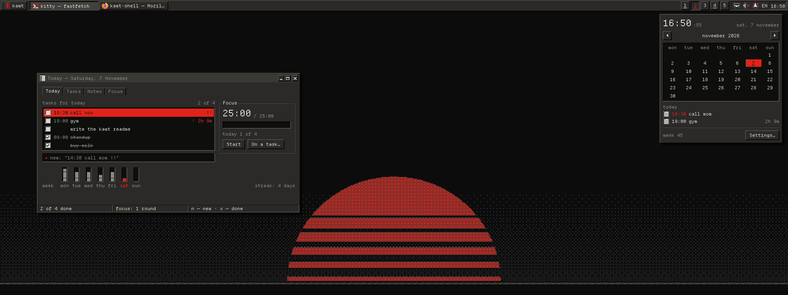

A [Quickshell](https://quickshell.org) shell for Hyprland that looks like an old system: a taskbar<br>
with a start button, raised buttons, real windows with a title bar and `_ □ ×`, message boxes.<br>
The configs that go with it come along (kitty, zsh, fastfetch, thunar, GTK), and so does **stripes**, who lives in it.<br>
<sub>graphite and one red light, like a ThinkPad · the pixel font Departure Mono · english, or russian in settings</sub>

[](#install)
[](https://hypr.land)
[](https://quickshell.org)
[](#install)
[](https://ollama.com)
[](LICENSE)

**[install](#install)** · [look](#look) · [the bar and the start menu](#the-bar-and-the-start-menu) · [desks](#floating-desks) · [your day](#your-day) · [panels](#the-panels) · [stripes](#stripes) · [ai](#ai) · [lock](#lock-and-boot) · [the rest](#the-rest) · [keys](#keys)

</div>

## Look

kawt is drawn like an old system: whatever you can press stands out and goes down while it's
pressed, fields and lists are sunk, a group of things sits in a groove with its name in the
frame, the one chosen in a list is red. kawt's own windows (today, system, settings,
wallpaper) are real Hyprland windows with a black title bar and a hard shadow; the panels under
the bar are raised boxes with their icon and name on top and `Settings…` at the bottom. Red is
the only light, like the dot on a ThinkPad's lid: where you are, what's chosen, a warning.

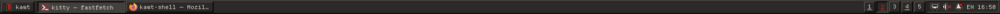


Two themes of its own, picked in `super + w`: **Graphite** (a black ThinkPad) and **Silver**
(the old grey, paper-light), and **From the wallpaper** (the same greys, lit in your wallpaper's
own color instead of red), each dark or light (`super + shift + w`), and your own
([below](#your-own-look)). Everything follows: GTK apps and thunar, kitty and other terminals,
Hyprland's borders, fastfetch, the prompt.

The words are in [Departure Mono](https://departuremono.com), a pixel font drawn on an 11 px
grid (SIL OFL, it comes with kawt in `fonts/`), sharp at 11 and 22. Long text (notes, the ai's
answers) is in IBM Plex Mono when it's installed. The panels' icons are kawt's own 16 px
stickers, in the theme's colors. Files and folders (on the desktop, in thunar, in the "open
file" windows) are **classic** by default: painted ones as desktops had them, tan folders seen a
little from above with their sign big on the corner, an open metal bin with crumpled paper, a
page for each kind of file; or **pixel** ones in the theme's colors (settings → look → icons).

<p align="center">
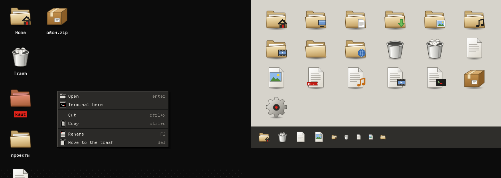<br>
<sub>files on the desktop and the classic icons, in 64, 32 and 16 px</sub>
</p>
<p align="center">
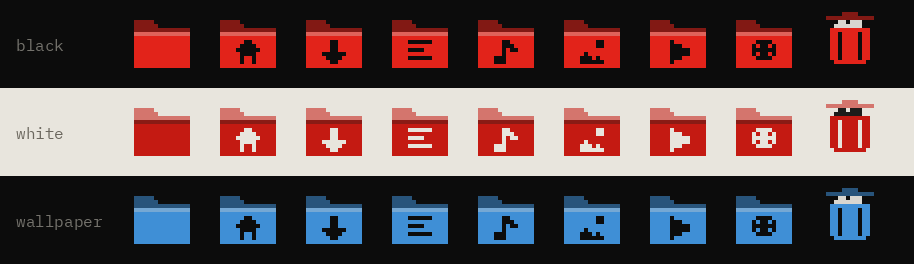<br>
<sub>or pixel ones, drawn in the theme you're on</sub>
</p>

**The cursor** stays the system's until you pick one of kawt's two (settings → look → cursor):
**Stripes**, cut in kawt's bars like the logo (busy: the bars run, red when nothing can be done
yet), or **Terminal**, the console's: fat pixels, typing on a red block, busy `| / - \`. Pixel
cursors, every pixel 1 to 4 times and never blurred; Hyprland draws them over every window and
tells GTK. Back to the system's, the one you had comes back.

<p align="center">
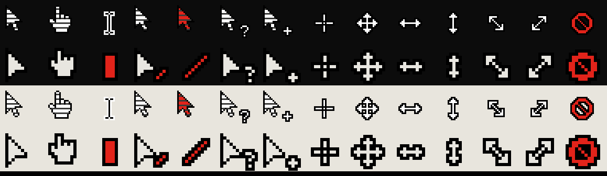<br>
<sub>Stripes and Terminal: arrow, hand, typing, busy, help, copy, crosshair, move, resize, not allowed</sub>
</p>

Twelve wallpapers of its own come with it, in the same tones: kawt in stripes, black and white
bars, stripes herself, the trackpoint, a sunset, an old prompt, graph paper. The installer puts
them in `~/Pictures/wallpapers/kawt` (a link into the repo: a `git pull` brings new ones;
delete it and it stays gone) and asks which one to start with, or none if you have your own.

<p align="center">
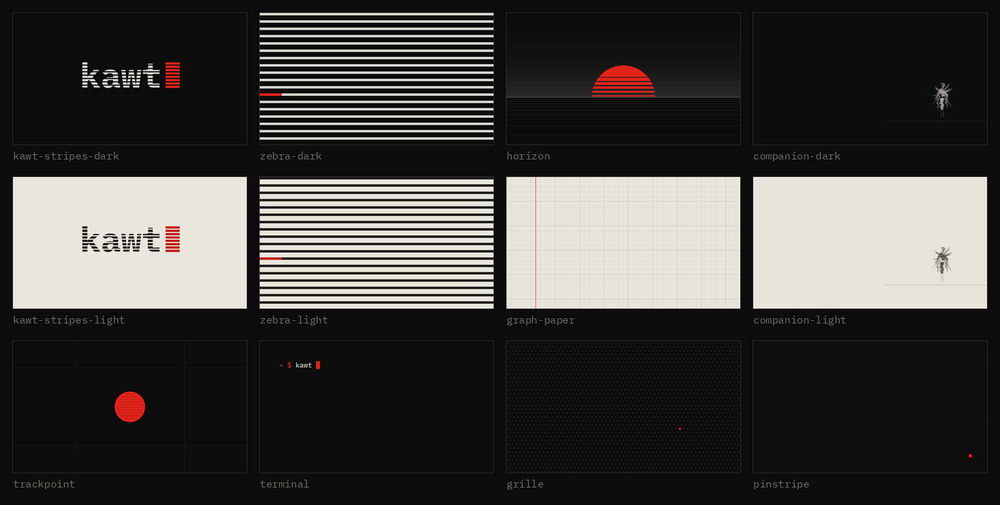
</p>

<div align="center">
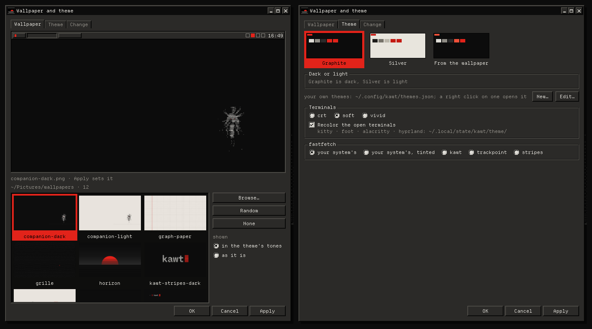<br>
<sub><code>super + w</code>: wallpaper and theme, like an old system's display properties. OK, Cancel, Apply</sub><br><br>
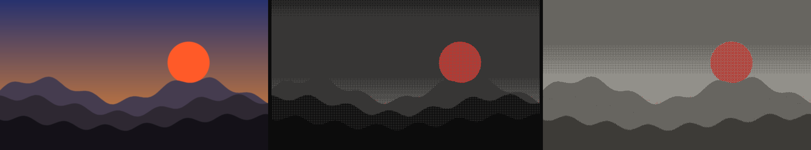<br>
<sub>any wallpaper in the theme's few tones, dithered like an old screen; its reds stay as red dots</sub>
</div>

## The bar and the start menu

The bar is a taskbar: the kawt button, the quick launch, the windows of the desk you're on (a
click goes to one; on a floating desk a click on the one in focus puts it away), the desks as
squares (underlined when something's on them; the wheel walks them, a right click: tile, free
like KDE, cascade, move the window here), then one sunk tray: the apps' icons (the ones that
don't fit behind `◄`), the network, sound, brightness, battery, messages, the keyboard layout,
the clock. Some show only while they mean something: a recording, a shared screen, caffeine,
a vpn, music, the mic while an app listens, bluetooth while something's connected (both can
stay, settings → bar). A tip comes up under each after a moment. The bar goes at the top or
the bottom, or tucks away (`super + shift + b`: a 2 px edge, the pointer there brings it out),
and any part can be switched off (settings → bar; it still works on its key). With many
windows the buttons give up their titles first, then the rest go into `+3 ▼`.

<p align="center">
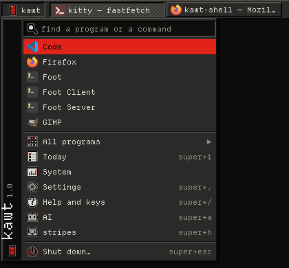
</p>

**The start menu** (the kawt button, `super + d`): a search on top, your pinned apps, then
**All programs** (by kind, a cascade the old way), **Today**, **System**, **Settings**, **Help
and keys**, **AI**, **stripes**, and **Shut down…** at the bottom. Typing searches at once;
`enter` on something not found runs it, or asks the ai.

<p align="center">
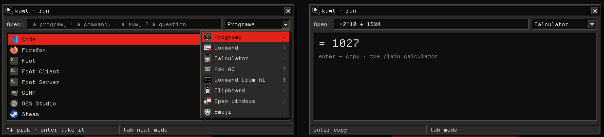
</p>

**The run box** (`super + space`) is the old Run window, in the middle of the screen: the mode
is a drop-down list on the right of the field (`tab` the next one, `alt + ↓` the list), or a
prefix typed straight in: `!` a command (`shift + enter` runs it in a terminal; the ones you ran
come back as a history) · `=` the calculator · `?` a short answer from the ai (`enter` again:
the whole talk in the ai panel) · `$` a command from the ai · `:` the clipboard, pictures with a
preview · `;` open windows · `.` emoji. The calculator's and the ai's answers come big in the
field, not as a line of a list; the status bar under it says what the keys do. Typed in the
wrong layout, it still finds it (`ашкуащч` → firefox). An app's own actions by name (`private` →
Firefox: New Private Window); `ctrl + s` pins, `ctrl + o` starts an app without internet from
then on. With `qalc` the calculator does units, currencies and dates (`=10 km to mi`,
`=today + 3 weeks`; exchange rates only the ones qalc has: kawt never makes it go online).

## Floating desks

A desk can be like KDE's: a right click on its square → **Free, like KDE** (or
`super + ctrl + v`) and every window there floats, where you put it, at any size. New ones come
out in the middle, one a little below another like old Windows did; windows moved in float on
their way, and back on a tiled desk they tile again. **Cascade** lines a messy desk up. A click
on the bar's button of the window in focus puts it away (minimized): its button stays on the
bar, dim, to bring it back; an app's own `_` button does that too.

Apart from desks, settings → windows: pick an app and it floats at its own size in the middle
from then on, on any desk.

Floating desks need Hyprland's Lua config (0.55+); with an old `hyprland.conf` the rest of kawt
works, the desks stay tiled.

## Files on the desktop

As in KDE: the desktop shows `~/Desktop` (or wherever `user-dirs.dirs` says it is), with the
home folder and the bin on top, a column after another, on the main screen. A click picks one
(`ctrl` one more), a band picks many; a double click or `enter` opens it with the app you chose
for its kind (a folder in the file manager, a launcher starts its app). Dragged, it stands
where you let it go, in the grid, and stays there. Right click: **Open**, **Terminal here**,
**Cut**, **Copy**, **Rename** (`F2`: the name in a field under the picture), **Move to the
trash** (`del`), **Ask AI** about a picture; on the empty desktop **New folder**, **New text
file**, **Paste**, **Arrange** by name / kind / date, **Line up**. A file dropped there from a
file manager is copied in; copied or cut ones paste into thunar too. The bin is the real one
(`~/.local/share/Trash`, thunar's "restore" works): full, it shows its paper; **Empty the trash**
asks once more. A picture file shows itself. Off in settings → look → icons.

## Your day

**Today** (the start menu's, or `super + i`) is a window of its own: a button on the taskbar,
moved by its title, `_ □ ×` as on any window. Your day, in four tabs:

<p align="center">
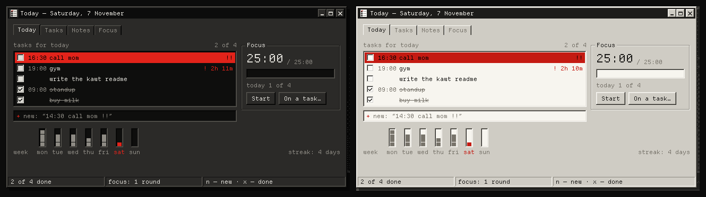
</p>

- **today**: the day in one look. Tasks due today or before, then the ones without a time, the
  ones ticked off today struck through; how soon each is and how important; the focus timer
  beside them; the week's rounds and the streak. Keys: `↑ ↓`, `x` done, `enter` open, `n` new.
  At the bottom: `2 of 5 done | focus: 3 rounds`
- **tasks**: folders, importance, reminders, notes inside a task, **steps** with a `▮▮▯ 2/3`
  progress, tasks that **come again** (every day, weekdays, week, month: type `every day`),
  done today and the streak; a ticked one is struck through and slides down. Keys: `j k` move,
  `x` done, `enter` open, `n` new, `r` how often, `f` focus on it
- **notes**: in folders, with search; a note is read first (`# headings`, `- [ ]` boxes that
  tick with a click), a click writes in it; pinned ones on top; a note from the clipboard, or a
  task from a note
- **focus**: a pomodoro (25/5 or 50/10) on a task or on nothing in particular; do not disturb
  while it works, stripes sits quietly, a notification at the end; rounds per day and a goal; it
  carries on over a restart (`kawt focus` from a key or a script)

<p align="center">
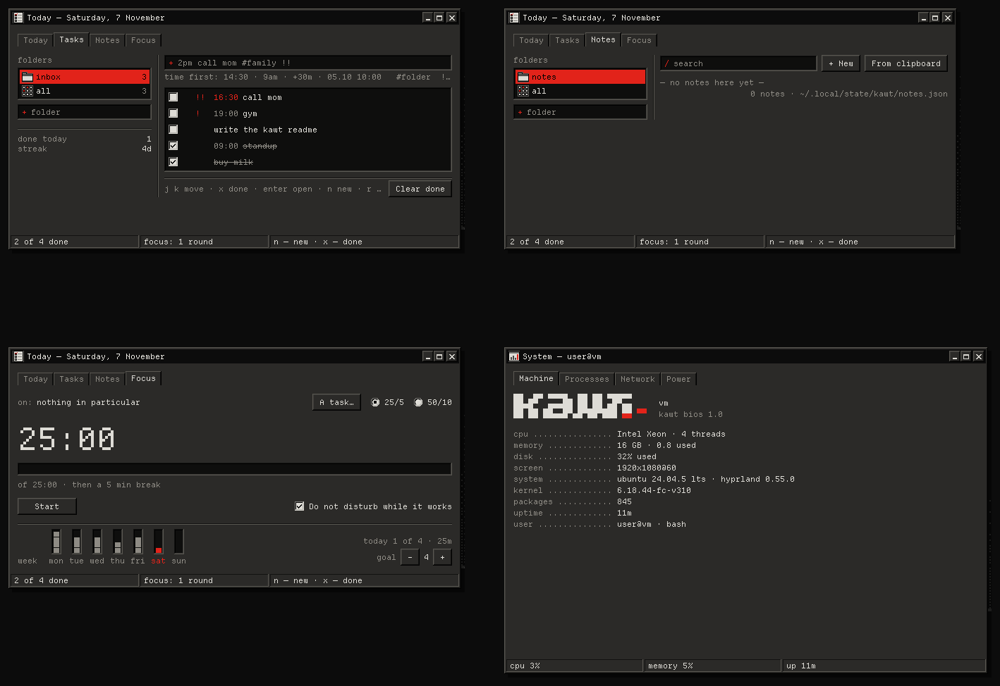
</p>

**System** (the start menu's) is the same kind of window, for the machine: **machine** like a
ThinkPad's bios setup; **processes**, cpu and memory over the last minute and the busiest ones
(a click twice: kill); **network**, who goes out to the internet right now; **power**, where
the battery stops charging (full / 80% / 60%), the power profile, the keyboard light, each only
where the machine has it. `qs -c kawt-shell ipc call kawt window system net` opens it at a tab.

<p align="center">
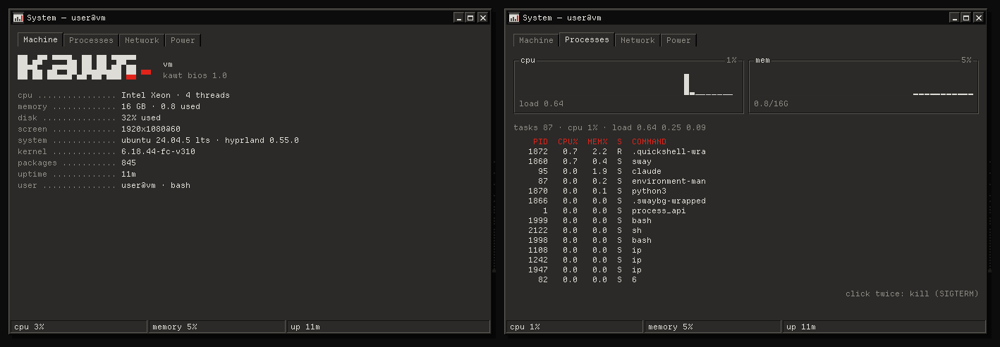
</p>

**Settings** (`super + ,`) is one window too, its pages in a list on the left: look, bar, screen
and lock, sound and media, keyboard and device, windows and desks, updates and kawt. What's
changed is saved at once; a dim line under each says what it does.

<p align="center">
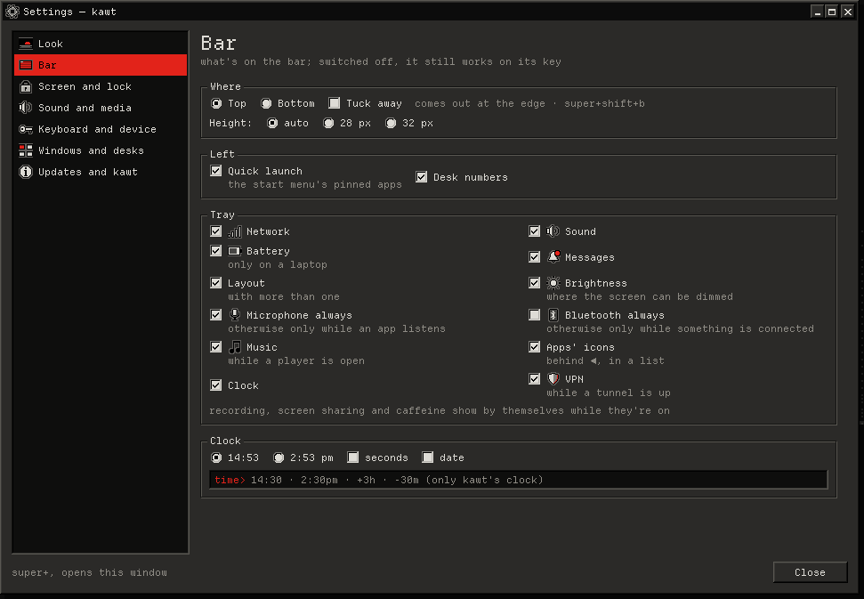
</p>

## The panels

<p align="center">
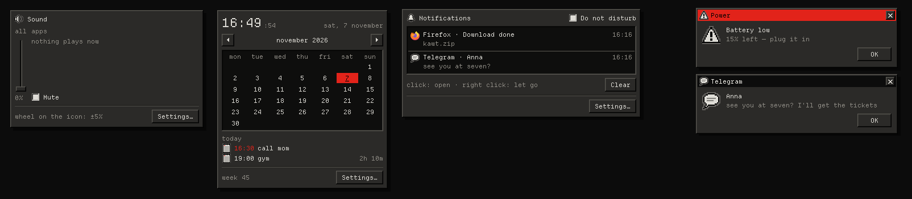
</p>

Each icon in the tray opens its own panel, under it: its icon and name on top (and its main
switch on the right), `Settings…` at the bottom, to the page it belongs to.

- **network**: Wi-Fi on or off; the networks nearby, the one in use red, a lock on the ones
  with a password, `open` on the ones without; the last minute between `↓` and `↑`; ip,
  gateway, the band. `Who's on the net…` opens the system window there: every program talking
  to the internet right now, with its connections and speed; **kill**, or **offline**: started
  from the launcher it gets no internet from then on (its own empty network, no root). `…`
  joins a hidden network by name
- **sound**: the whole of it standing on the left, each app that plays beside it, mute; the
  output when there's a choice. The wheel on the icon: ±5%
- **power** (a laptop): the battery big and how long it lasts, the mode (quiet / balanced /
  fast), where the charging stops, the brightness and the night light
- **calendar**: the time big, the month with `◄ ►`, today red, the days with a task underlined,
  today's tasks under it
- **notifications**: do not disturb, the messages with their app's icon and time, `Clear`
- **microphone, bluetooth, the player, the hidden tray icons**: the same way

Messages come as little message boxes on the right (over the tray when the bar is at the
bottom): the app in the title (an urgent one's title red), its icon big, its own buttons and
`OK`.

kawt itself stays quiet on the net: one `git fetch` a week to know about updates (off in
settings → kawt), nothing else unless you ask (the ai on an api you picked, `ollama pull`).

## stripes

<p align="center">
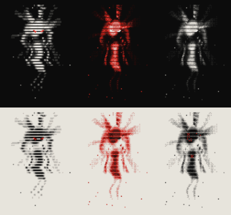
</p>

**stripes** lives in kawt: a stain of glitching data in a girl's outline. Noise eats her edges,
she boils inside, her hair runs off in blurred strands every way; only the eyes are sharp, and
they follow the pointer. Three looks: **stripes** (cut in kawt's bars), **red**, **ink**. By
default she picks herself (stripes when calm, red when busy: music, the coder, a recording; ink
at night and asleep) and changes through a glitch. On a light theme she's ink and red ink on
paper. She's a small shader on a 72 x 108 grid, stretched soft, at 12 frames a second, and only
while she's on the screen.

- **on an empty desktop** she walks along the bottom edge, dances to music and falls asleep when
  nothing happens for a while; a window opens and she goes. Click her to talk (asleep: she wakes
  up), drag her along the edge, double click: away for an hour
- **out of the corner** she peeks when the battery gets low, the charger comes, a screenshot is
  taken, the recording starts, a reminder rings, a new kawt is out; never over a fullscreen
  window or in do not disturb. `super + h` calls her out of the corner, and lets her go again
- **next to the coder** she thinks, types, and puts kawt's red block over her head when a diff
  waits for you
- she keeps the **focus timer** with you, and on the first start **shows you around** (english
  or russian)

Start → stripes is her window: her look, whether an empty desktop is hers, a pomodoro, her
name, your own phrases for her (said when you click her), wise words now and then (`fortune-mod`
gives her more, in english). Off in settings → kawt: then nothing runs for her.

## AI

<table>
<tr>
<td width="34%" valign="top">
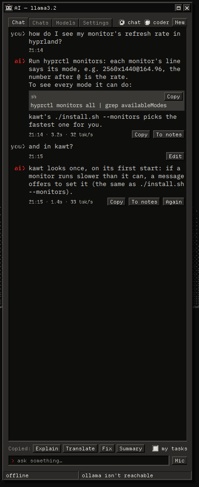<br>
<sub>a local model: nothing leaves the machine</sub>
</td>
<td valign="top">

`super + a` (or start → AI): a kawt window at the screen's edge (`□` makes it wide, with the
project's files on the left), tabs **Chat · Chats · Models · Settings** (`ctrl + tab` walks
them). Chat with a local [ollama](https://ollama.com) model (or any OpenAI-compatible api),
saved chats, markdown answers with code to copy, compare two models; models installed, pulled
and unloaded from the panel, with limits so it doesn't eat the machine.

- `?question` in the run box for a short answer, `$what you want` for one shell command (it
  never runs by itself), `super + alt + a` on the text you marked in any window
- **Copied:** Explain · Translate · Fix · Summary, one click on what's on the clipboard
- a screenshot's **Ask AI** brings the picture to a model that sees
- **my tasks** gives it your todo list ("what's on tomorrow?")
- `super + alt + v`, or **Mic**: speak, `whisper-cpp` writes it down on this machine

</td>
</tr>
</table>

**coder**: an agent in one project folder. It lists, searches and reads; every change is a diff
to **Apply** or **Skip**; commands (with `bubblewrap`) run only after **Run**, in a sandbox
without network where the project is the only place it can write, and what they changed is
listed file by file (with `git`: kawt keeps its own copy in `~/.cache`, never touching the
project's `.git`; what `.gitignore` hides isn't watched). **Changes** shows every file it changed
as a diff, each with its own **Undo**; **Undo** puts everything back.

## Lock and boot

<p align="center">
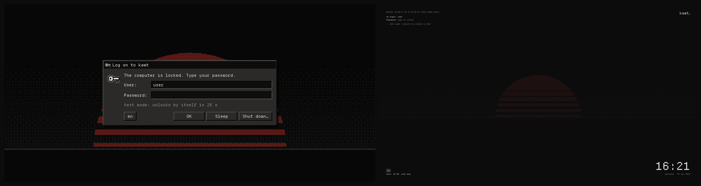
</p>

The lock is an old system's log-on window over the wallpaper dimmed with dots: who you are, the
password, `Caps Lock is on` when it is, `OK`, `Sleep`, `Shut down…`. Or a text console at its
login, as kawt had it first (settings → screen and lock → looks like). Either switches on like
an old picture tube and off again into a line. It locks before the machine sleeps, on
`loginctl lock-session` and after 10 idle minutes (the backlight dims 30 s before); a minute
later the picture goes off (only the picture: wifi, music and downloads go on).
`kawt lockTest` tries it safely. No hypridle / hyprlock needed.

**Shut down…** (start, or `super + escape`) is the old dialog: shut down, restart, sleep, log
out, lock, a letter each, `OK` / `Cancel`; the ones that end the session count down 5 s first.

<p align="center">
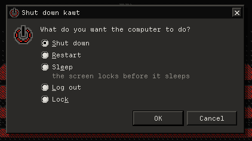
</p>

Once per login a bios-like check list runs (`kawt bios 1.0 ·` your machine: cpu mem disk (bat)
`ok`), then the desktop opens from a bright line; any key skips. Both can be switched off
(settings → look).

## The rest

| | |
|---|---|
| player | the tray's note while music plays (real sound with `cava`); click: the cover in big pixels, a level-meter spectrum, `|<` `||` `>|`, the position, shuffle, loop, the player's own volume, tabs when several play, this session's tracks |
| screenshots | area / window / screen, the screen still while you pick; a small window in the corner: **Copy**, **Save**, **Open**, **Draw on it** (`satty`), **Text** (`tesseract`), **Ask AI** |
| recording | the tray's red dot and the time; area or screen; sound: off, the mic, what you hear, or both |
| osd | a raised plate with red segments for the volume and the brightness; the charger in or out shows the battery; low battery at 20 / 10 / 5% |
| notifications | kawt is the daemon: a history, do not disturb, keeps what the app asks for (`notify-send -t`, `-e` transient, replace tags) |
| theme export | a theme switch recolors open terminals and GTK apps live and rewrites colors for kitty, Hyprland's borders, GTK, foot, alacritty, shell scripts and kawt's folder icons; terminal colors as `crt`, `soft` or `vivid` |
| fastfetch | `kawt · arch linux` on top, then the system in full words, memory and disk as bars; your system's logo in its own colors (or the theme's), kawt in blocks, the trackpoint, kawt in stripes, or a picture (stripes, `~/.face`, one of yours) dithered in the theme's tones, drawn by kitty; a narrow window gets the small logo. Nothing that says who or where you are, safe to screenshot |
| prompt | zsh: the folder inverted like a bios's chosen line, the git branch on grey, a failed command's code on red, `>` in red where you type; hints from history, typos marked |
| a crash | kawt runs under a small keeper (`scripts/keep.sh`): it starts again a second later, and if the screen was locked it locks again at once; five crashes in two minutes and it stays off, Hyprland says so. `qs kill -c kawt-shell` stops it for good |
| old machine | settings → look: no blur, shadows or animations, graphs half as often, no visualizer (a T60, an X200); `scanlines` for faint tube lines |
| keys | `super + /`: every key of the desktop in a window, tabs **kawt · Hyprland · Inside kawt**, a search across all three |
| also | night light (`hyprsunset`), volume per app, brightness (on a desktop the monitors' own, over DDC/CI), the keyboard layout (one per window if you like), a theme of your own (`super + w` → Theme → New…, a little desktop drawn in its colors as you type) |

Works on a laptop and a desktop alike: what a machine doesn't have (a battery, a backlight,
power profiles, charge thresholds, a keyboard light) simply doesn't show.

## Install

```sh
git clone https://github.com/kfrttlw/kawt-shell ~/kawt
cd ~/kawt
./install.sh
```

```
-- what should go on this machine? --
 > everything       shell, terminal, prompt, fastfetch, thunar and the extras
   only the shell   the bar and panels + hyprland binds, nothing else
   let me pick      part by part
```

A menu asks which system this is (it guesses: Arch-based or not) and what to install
(arrows, space, enter). Then it shows the plan, and after a yes it does it; on the first start
stripes says hello. It never runs as root (it asks for sudo itself, only for pacman), and
running it again is safe. `./install.sh --fresh` starts over as on a new machine (all of kawt's
setup to a backup, every question again).

<details>
<summary><b>what the installer does, step by step</b> (after the plan and your yes; what it replaces goes to a backup)</summary>

- installs what's missing with `pacman` (one `sudo pacman -Syu --needed ...`: the system is
  updated in the same go, Arch doesn't like half-updated systems; you can switch that off).
  Quickshell comes from the AUR if the repos don't have it: with `paru` or `yay` if you have
  one, otherwise built right there with `makepkg` (no helper needed). `pacman -Syu` never
  updates AUR packages: run `./install.sh` again now and then and it updates quickshell when
  the AUR has a newer one, and builds it again after a Qt update (`./doctor.sh` tells you
  when either is due). With paru / yay, their `-Syu` does the same
- symlinks the configs, so `git pull` updates everything in place. Configs that are already
  there are replaced but kept in `~/.local/state/kawt/backups/<date>/`
- gives your `hyprland.lua` one line that loads `hypr/kawt.lua` (wrapped in `pcall`, so a
  broken kawt can never take Hyprland down). Your own config stays yours, unless you pick
  **kawt's standard config**: CRT-style animations (windows open out of a line, no bouncing),
  square windows, small tools and dialogs floating at their own size instead of stretched,
  `super + v` floating ↔ tiled at 900x600 in the middle, a window mode on `super + z` (arrows
  resize, `shift` + arrows move, `f` float, `c` center, `p` pin), resize on
  `super + ctrl + arrows`, media keys through kawt's osd. Then `hyprland.lua` is three lines:

  ```lua
  dofile(".../kawt-shell/hypr/preset.lua")         -- the standard config: git pull updates it
  pcall(dofile, ".../kawt-shell/hypr/kawt.lua")    -- kawt's keys and theme colors
  dofile("~/.config/hypr/user.lua")                -- yours, last: it wins
  ```

  and everything of your own goes to `~/.config/hypr/user.lua` (made once, never replaced):
  monitors, layouts, mouse speed, `preset.terminal = "foot"` (and `files`, `browser`), any
  setting again (the last one counts). A key bound twice does both, so free a standard one
  first: `preset.unbind("SUPER + B")` (kawt's own keys: `kawt.unbind("SUPER + H")`), then bind
  yours. Each part of the standard config runs
  in its own `pcall`: one that doesn't fit your Hyprland version is skipped, not the rest.
  Your old `hyprland.lua` goes to the backup (`user.lua` says where); `--uninstall` puts it
  back, or, with none, copies the standard config into `hyprland.lua` so it works without
  kawt. Never started Hyprland yet, so there's none: the standard config is the default, or
  Hyprland's own (`/usr/share/hypr/hyprland.lua`, what Hyprland would write itself) without
  the two binds kawt uses (`super + r`, `super + shift + s`)
- keyboard layouts next to `us` (`alt + shift` switches; it offers the ones of your old config,
  or guesses from your language, `ru_RU` → `ru`), and the monitors: each at its best mode (the
  biggest size, then its highest rate, written out: `2560x1440@164.96`, not `preferred`, which
  is often 60 Hz), or picked by hand: its size, then its rate, or off; the scale from how dense
  the screen is (its size in the EDID: `27", 109 ppi → x1`), or 1 / 1.25 / 1.5 / 2; or left to
  Hyprland. With two or more they're drawn side by side as a little map: `←→` moves one along
  the row, `space` makes it the main one (★, desk 1 opens there); the positions come from the
  order. They're written into `user.lua` as `hl.monitor({ output, mode, position, scale })`,
  between two comment lines, easy to change by hand. Inside Hyprland each one is checked (one
  that didn't get the mode asked for is said), then, as old systems' screen settings did:
  **keep it like this? y / n**, and without a yes in 15 s it goes back as it was. From a console
  it knows the sizes only: on its first start kawt sees if a monitor runs slower than it can
  ("DP-1 runs at 60 Hz, it can do 165") and offers to set it. Again any time:
  `./install.sh --monitors`
- kawt's pixel font (Departure Mono) linked into `~/.local/share/fonts/kawt` for GTK apps, and,
  if you say so, for kitty too (small: 8.25 pt; `~/.config/kitty/kawt-font.conf`)
- the first wallpaper, on a new install: kawt in stripes, the sunset, stripes herself, the bars,
  or none (picked first when hyprpaper, swaybg or the like still draws yours)
- an NVIDIA card: offers Hyprland's environment for it (`hypr/nvidia.lua`: video decoding on
  the gpu, OpenGL through nvidia; not on a hybrid laptop, where the intel / amd gpu draws) and,
  if there's no driver yet, the driver: `nvidia-open-dkms` for Turing and newer (GTX 16xx,
  RTX), `nvidia-580xx-dkms` from the AUR for GTX 9xx / 10xx (with paru or yay), with the
  kernel headers, `libva-nvidia-driver`, `lib32-nvidia-utils` when multilib is on and
  `nvidia-prime` (`prime-run`) on a hybrid. Older cards: by hand. A reboot after
- also installs what a fresh Hyprland lacks: sound for browsers and Discord (`pipewire-pulse`),
  screen sharing and "open file" windows (`xdg-desktop-portal-hyprland`, `-gtk`), the password
  window for apps that need admin rights (`hyprpolkitagent`, started by kawt), the play / pause
  keys (`playerctl`) and emoji (`noto-fonts-emoji`). Still on pulseaudio, or another polkit
  agent: those are left alone
- no login screen (display manager) on the machine: asks how Hyprland should start after you
  log in on the console: by itself on tty1 (a line in `~/.zprofile`), with a `start` command
  (in `~/.zshrc`; a `start` of your own is kept), or neither (not asked again). Both go
  through `hypr/login.sh`: `uwsm` if you have it, otherwise `start-hyprland`
- installs zsh (with `zsh-autosuggestions` and `zsh-syntax-highlighting`, the history hints and
  the typo marks) and adds one line to the end of your `~/.zshrc` that loads the prompt. No
  `~/.zshrc` yet: it starts from `zsh/starter.zshrc` (history, tab completion, keys), because
  bare zsh doesn't even keep a history. If your terminals open bash, it asks to make zsh your
  shell (`chsh`). oh-my-zsh isn't needed; if you have it, kawt's line comes after it and wins
- asks before starting any service (bluetooth, ollama, power profiles). NetworkManager is never
  installed for you: next to iwd or systemd-networkd it can take the network over. It asks
  whether NetworkManager may keep asking a server every few minutes if there's internet (the
  one thing on a fresh Arch that goes out by itself; it finds wifi login pages in cafés)
- who draws the wallpapers, while neither `awww` nor `swww` is there: `awww` (transitions,
  `crt` among them; kawt starts it), kawt itself (nothing more to install, a plain fade), or
  yours (hyprpaper, swaybg...: kawt leaves the wallpaper alone). Makes `~/Pictures/wallpapers`,
  where `super + w` looks
- thunar (a part of its own): installs it with `gvfs` (drives, trash) and `tumbler`
  (thumbnails), and folders open in it. GTK apps (thunar, the "open file" windows) take the
  theme's colors through `adw-gtk3`: `~/.config/gtk-3.0/gtk.css` and `gtk-4.0/gtk.css` link to
  what kawt writes on every theme switch (yours goes to the backup), dark or light with it,
  square like the rest. And kawt's own folder icons: pixel folders in the theme's color, with a
  sign on home, downloads, music, pictures... and the trash (an icon theme `kawt`; every
  other icon is Papirus). All from the Arch repos, all in your home folder
- before pacman, says what would stop it halfway: another pacman running (or the lock one
  left behind: it offers to take it away), less than 1 GB free, no internet
- other bars, notification daemons and wallpaper programs (waybar, dunst, mako, swaync,
  hyprpaper...) running or started in your Hyprland config: listed, and stopped and commented
  out if you say so (only one program can show notifications)
- at the end Hyprland checks its config (`Hyprland --verify-config`) and says what's wrong in
  it; inside Hyprland kawt starts right away, and a few seconds later it's looked at: still
  running, and nothing in its log that stopped a part from loading
- everything it prints also goes to `~/.local/state/kawt/install.log`: the file to look at, or
  to send along, when something went wrong

</details>

Packages are installed on Arch and what's built on it (EndeavourOS, CachyOS, Manjaro...).
On another distro the installer still sets up everything of kawt's own (configs, binds,
prompt, fastfetch) and lists what to install yourself; quickshell itself: see
[quickshell.org](https://quickshell.org).

```sh
./install.sh --dry-run       # see what it would do
./install.sh --all --yes     # everything, no questions
./install.sh --shell-only    # just the shell
./install.sh --no-packages   # only link the configs, leave pacman alone
./install.sh --no-update     # install what's missing, no system update
./install.sh --uninstall     # remove the links and lines, put your old configs back
./install.sh --fresh         # from scratch: all of kawt's setup to a backup, then every question again
./install.sh --update        # kawt itself, see below
./install.sh --rollback      # back to the version before the last update (again: forward)
./install.sh --check         # is everything it needs installed? only says (doctor.sh asks too)
./install.sh --monitors      # your monitors: auto, or each one by hand (mode, position, scale)
./install.sh --help
```

**Updating.** `./install.sh --update` (or **Update** in settings → kawt, or
`qs -c kawt-shell ipc call kawt update`): shows what's new, asks, `git pull`s, then the new
installer adds what the new version needs for the parts you have (new packages, links), starts
the shell again and reloads Hyprland. Optional packages new in that version are offered with
what they're for. Every update, and an "up to date" one too, also checks that all the packages
of your parts are there and that their libraries are: what `pacman -Dk` finds missing gets
installed, and an AUR quickshell that can't load its own libraries (`ldd`) is built again. Your
own things are outside the repo and stay as they are; changes made inside the repo stop it,
with a list (`git stash` can put them aside). Knowing about a new version means asking github:
**Check** in settings → kawt does it once (`git fetch`), and kawt does it by itself once a
week, with a notification only when there's something new (stripes peeks out to say so too).
"look for updates once a week" there switches that off: then nothing goes out unless you press
**Check**.

An update broke something, and the fix isn't out yet? `./install.sh --rollback` goes back to the
version before it (every update keeps which one that was), with the shell started again and
Hyprland's config read again; once more and it goes forward again, and so does the next update.
It works from a console too, when the desktop itself is what broke.

Keep the clone somewhere permanent (like `~/kawt`): the configs point into it. Don't clone it
into `~/.config/quickshell/kawt-shell` itself; the installer refuses that.

**Needs:** `quickshell` `hyprland` `kitty` `ttf-ibmplex-mono-nerd` `papirus-icon-theme` `libnotify` `grim` `slurp` `wl-clipboard` `cliphist` `wf-recorder` (brings `ffmpeg`), `hyprpicker` (the still screen for screenshots), `brightnessctl` on laptops.
For the rest of the desktop: `pipewire-pulse` `xdg-desktop-portal-hyprland` `xdg-desktop-portal-gtk` `hyprpolkitagent` `playerctl` `noto-fonts-emoji`.
Services kawt talks to: `networkmanager` (wifi), `pipewire` (sound, mic), `upower` (battery), `bluez` (bluetooth), and systemd-logind with `glib2` (`gdbus`, for locking before sleep).
**Optional:** `zsh` + `git` (prompt), `zsh-autosuggestions` + `zsh-syntax-highlighting` (hints and typo marks in the prompt), `fortune-mod` (more wise words for stripes), `ollama` (ai panel), `awww`/`swww` (wallpapers), `cava` (real sound bars next to the player), `power-profiles-daemon`, `hyprsunset` (night light), `satty` (**Draw on it** on screenshots), `tesseract` + `tesseract-data-eng` / `-rus` (**Text** on screenshots), `libqalculate` (units and currencies in the `=` calculator), `wtype` (emoji typed in), `bubblewrap` (the coder runs commands in a sandbox), `whisper-cpp` (speaking to the ai), `ddcutil` on a desktop (the monitors' brightness; the installer loads `i2c-dev` for it).

The wallpaper theme measures each new wallpaper with `ffmpeg` (it comes with `wf-recorder`);
without it, only while `super + w` is open.

## Keys

<p align="center">
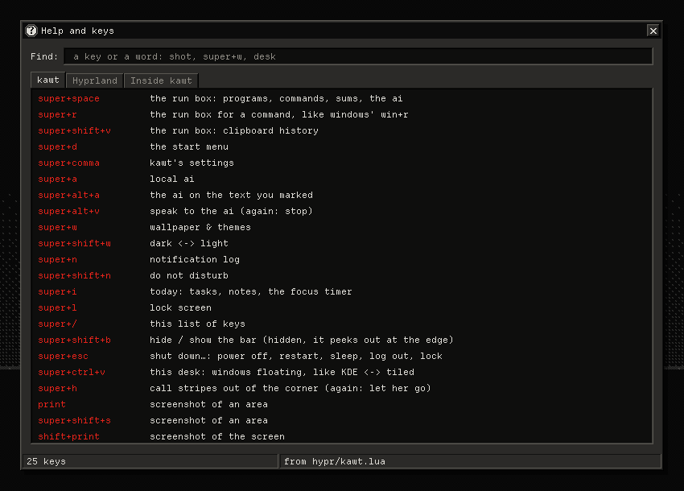
</p>

| | |
|---|---|
| `super + space` | the run box |
| `super + r` | the run box for a command |
| `super + shift + v` | the run box: clipboard history |
| `super + d` | the start menu |
| `super + a` | ai panel |
| `super + alt + a` | the ai on the text you marked (any window, nothing copied): explain / translate / fix / summary, then copy, replace it, or go on in the chat |
| `super + alt + v` | speak to the ai (again: stop); whisper.cpp writes it into the panel, on this machine |
| `super + w` / `super + shift + w` | wallpaper & themes / dark ↔ light |
| `super + n` / `super + shift + n` | notifications / do not disturb |
| `super + i` | today: tasks, notes, the focus timer |
| `super + ,` | settings |
| `super + ctrl + v` | this desk: floating like KDE ↔ tiled |
| `super + h` | call stripes out of the corner (again: let her go) |
| `super + l` | lock screen (it also locks by itself: before sleep, and after 10 idle minutes; any time or off in settings → screen) |
| `super + /` | help and keys: a window with every key (read from `hypr/kawt.lua`, then the binds of your config that end with a `-- comment`: `hyprland.lua`, or `user.lua` and the standard config), and the ones inside kawt; typing finds |
| `super + shift + b` | tuck the bar away / back |
| `super + escape` | shut down…: shut down / restart / sleep / log out / lock, with a 5 s countdown |
| `print` / `super + shift + s` | screenshot of an area (`shift + print` screen, `alt + print` window), then copy / save in the corner |
| `super + shift + r` / `super + alt + r` | record an area / the screen (same key again: stop) |

In the run box: `↑↓` pick, `tab` the next mode, `alt + ↓` the modes, `shift + enter` a command in a terminal, `ctrl + s` pin, `ctrl + o` no internet for that app, `ctrl + d` forget (a command, a clip).
In the todo: `j k` move, `x` done, `enter` open, `n` new, `r` how often, `f` focus on it.
In `super + w`: arrows pick a wallpaper, `enter` sets it, `r` a random one, `t` dark ↔ light, `esc` puts back what was on.
In today: `↑ ↓` pick, `x` done, `n` new, `enter` open it in tasks.

Everything is also reachable over IPC, for your own binds or a timer:
`qs -c kawt-shell ipc call kawt toggle <panel>`, `... kawt window today|system|style <tab>`,
`kawt settings look|bar|screen|media|device|windows|kawt`, `kawt wallpaper next|prev|random|none|<path>`,
`kawt suspend` (locks, then sleeps), `kawt caffeine`, `kawt idle <minutes>` (0 = never), `kawt night`,
`kawt volume up|down|mute`, `kawt mic mute`, `kawt brightness up|down|<percent>`,
`kawt media toggle|next|prev|back|forward` (the player the bar shows), `kawt bar [show|hide]`,
`kawt desk [float|tile|cascade]`, `kawt companion pet|call|sleep|wake|focus|walk|home|toggle`,
`kawt focus [stop|pause]`, `kawt welcome` (the first start's tour again), `kawt theme new|edit` (the theme editor), `kawt selection`, `kawt voice`.
The volume, mic, brightness and media ones are for the media keys. kawt's standard config binds
them already; in a config of your own, remove your XF86 binds, then one line after the one that
loads kawt: `kawt.media_keys()` in `hyprland.lua` (or, in an old `hyprland.conf`,
`source = ~/.config/quickshell/kawt-shell/hypr/kawt-media.conf`). Through kawt, the osd shows at
once.

One of kawt's keys is taken by something of yours (`super + h` and `super + l` move the focus
in many configs)? Free it after the line that loads kawt, then bind your own:
`kawt.unbind("SUPER + H")` in `hyprland.lua` or `user.lua` (`unbind = SUPER, H` in an old
`hyprland.conf`). The key list (`super + /`) follows. What the key did stays on its ipc call,
for another key.

## Your own look

Nothing in the repo has to be edited, so updates never fight with your changes:

- **font, look, bar**: settings → look and bar. The font (Departure Mono at 11 or 22, or any
  monospace one at any size: the panels grow with it), the language, the tube effects, the
  boot screen, scanlines, old machine; the bar at the top or the bottom, its height, and which
  parts it shows (one switched off still works on its key; a recording, a shared screen and
  caffeine always show while they're on)
- **colors**: `New…` and `Edit…` on the theme tab of `super + w` make and change themes
  without typing: a name, the colors of dark and light as hex (or picked off the screen with
  hyprpicker), the bar's own color if it should differ. Graphite and Silver keep only what you
  change, reset gives kawt's back. It all goes to `~/.config/kawt/themes.json`, read again
  whenever it's saved, so it can be written by hand too. A new name is a new theme; `thinkpad`
  changes only the colors you give:

  ```json
  {
    "matrix":   { "dark": { "bg": "#000000", "fg": "#00ff41", "dim": "#00802a", "border": "#003b00",
                            "accent": "#b6ffc8", "warn": "#ff3b30", "hoverFill": "#061a0b" } },
    "thinkpad": { "dark": { "accent": "#ffffff", "bar": "#1c1c1c" } }
  }
  ```

  a missing color comes from the theme of the same name (or `thinkpad`); a new theme with only
  `dark` (or `light`) uses it for both; `face`, `hi` and `lo` give the raised frames their own
  colors (otherwise they come from the rest). Something wrong in the file: `super + w` says what
- **hyprland**: `~/.config/hypr/user.lua` (see the installer part above)

Nothing has to be set in the environment. The icon theme is picked in `shell.qml`
(`//@ pragma IconTheme Papirus-Dark`); to use another one, set `QS_ICON_THEME` for the `qs`
process. The ai panel talks to a local ollama by default, no API key involved; if you switch it
to an OpenAI-compatible api, the key is kept in `~/.local/state/kawt/secrets.json`, readable
only by you, never in the repo.

## Where things live

- `~/.local/state/kawt/settings.json`: theme, wallpaper, ai model, font, bar...
- `~/.config/kawt/themes.json`: your own themes
- `~/.local/state/kawt/todo.json`, `notes.json`, `focus.json`, `chats.json`: your tasks, notes,
  focus rounds and ai chats (`./install.sh --fresh` keeps them unless you say no)
- `~/.local/state/kawt/companion.json`: stripes' own (when you met, the phrases you gave her)
- `~/.local/state/kawt/launcher.json`: pinned apps, how often you start each, the ones without
  internet
- `~/.local/state/kawt/windows.lua`: what kawt tells Hyprland about windows (the apps that
  float, the floating desks)
- `~/.config/hypr/user.lua`: your Hyprland settings, with kawt's standard config
- `~/.local/state/kawt/theme/`: generated color files, rewritten on every theme switch (the
  gtk colors and kawt's folder icons too)
- `~/.local/state/kawt/install.log`: what the last install or update did

## Layout

```
quickshell/kawt-shell/   the shell        -> ~/.config/quickshell/kawt-shell
  config/                settings, themes, sizes
  services/              what kawt knows and does (wifi, sound, todo, the ai, stripes...)
  modules/               what you see: the bar, the start menu, the panels, kawt's windows
                         (today, system, settings, wallpaper and theme), the lock, stripes
  components/            the parts they're made of (buttons, frames, fields, windows, icons)
  fonts/                 Departure Mono (SIL OFL), kawt's pixel font (-> ~/.local/share/fonts/kawt)
  cursors/               kawt's two cursors, XCursor (drawn by tools/cursors.py; -> ~/.local/share/icons once picked)
  data/                  the emoji list, stripes' picture for fastfetch
  shaders/               stripes (stripes.frag, built into stripes.frag.qsb)
  scripts/               the shell scripts kawt runs
  hypr/kawt.lua          Hyprland binds   (loaded from hyprland.lua; kawt.conf for an old hyprland.conf,
                         kawt-media.conf its media keys, if you want them through kawt)
  hypr/preset.lua        kawt's standard Hyprland config (with hypr/hyprland.lua + hypr/user.lua)
  hypr/nvidia.lua        Hyprland's environment for an nvidia card (the installer adds it on a yes)
  hypr/login.sh          starts Hyprland from the console: at login on tty1 or with `start`
  scripts/keep.sh        keeps kawt running: started again after a crash (Hyprland starts this, not qs itself)
  zsh/kawt.zsh-theme     prompt           (sourced from ~/.zshrc)
  zsh/starter.zshrc      a first ~/.zshrc (copied only if you have none)
kitty/kitty.conf         terminal         -> ~/.config/kitty/kitty.conf
fastfetch/config.jsonc   fastfetch        -> ~/.local/state/kawt/theme/fastfetch.jsonc (kept in the theme's colors)
wallpapers/              kawt's own       -> ~/Pictures/wallpapers/kawt
install.sh
```

## Development

```sh
python3 tools/check.py   # catches the mistakes that stop the shell from loading (and kawt's words: both languages, their %1)
./doctor.sh              # where the "theme -> files -> apps" chain breaks on this machine
./colortest.sh           # which kind of terminal color something uses
tools/mem.sh -w          # how much ram and gpu memory kawt takes, live
tools/net.sh -w          # which programs talk to the internet, live (the wifi panel's who's out, in a terminal)
tools/qsb.sh             # builds the shaders again after a change (qt6-shadertools)
python3 tools/cursors.py # draws kawt's cursors again after a change in it (--check, --preview sheet.png)
tools/load-test.sh       # does kawt load? in a headless sway, every panel and window opened (sway, quickshell)
```

The same check runs on every push and pull request (`.github/workflows/check.yml`), with
`shellcheck` over the scripts, the Lua files' syntax and whether the cursors in the repo are what
`tools/cursors.py` draws; and a second job loads kawt for real, in an Arch container with
quickshell and a headless sway, every panel, window and settings page opened (`tools/load-test.sh`).

## License

[GPL-3.0](LICENSE): use it, change it, share it; what you build on it and share stays open
too, under the same license.
Departure Mono (`quickshell/kawt-shell/fonts/`) is Helena Zhang's, under the
[SIL Open Font License](quickshell/kawt-shell/fonts/OFL.txt).
