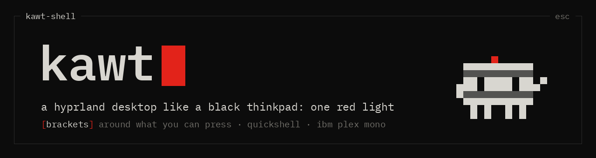
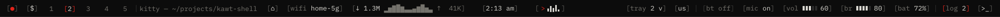
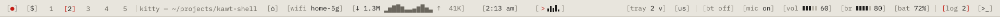
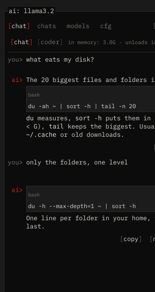
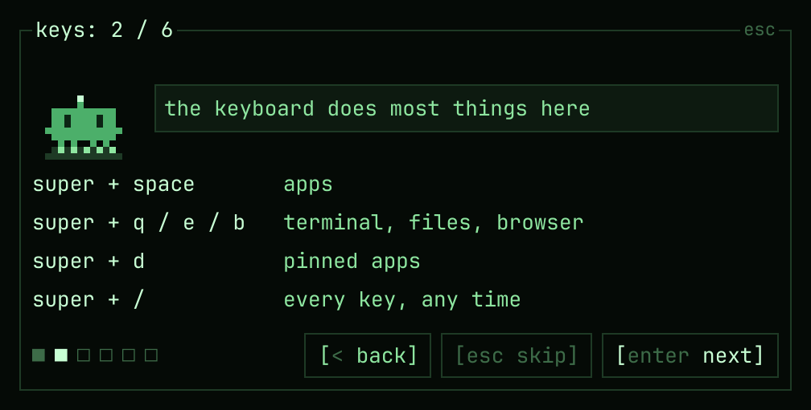
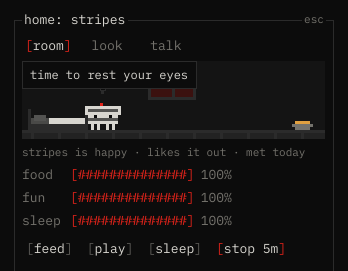
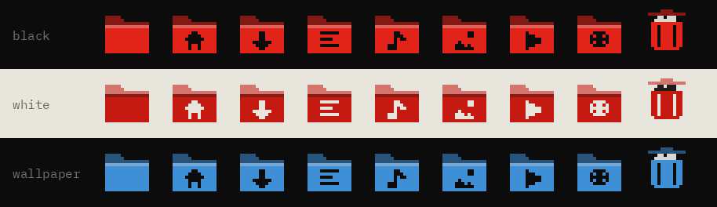
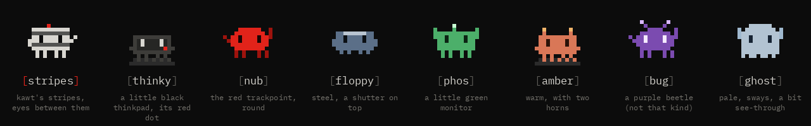
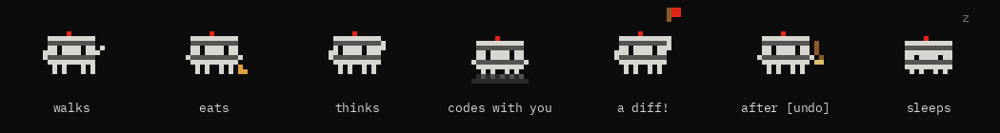

<div align="center">



A [Quickshell](https://quickshell.org) desktop shell for Hyprland, plus matching configs,<br>
all in one monospace, square-cornered, text-first style.<br>
<sub>ThinkPads, green phosphor, Mr. Robot, <code>[brackets]</code> everywhere</sub>

[](https://hypr.land)
[](https://quickshell.org)
[](#install)
[](https://ollama.com)
[](LICENSE)

**[install](#install)** · [look](#look) · [what's inside](#whats-inside) · [the companion](#the-companion) · [keys](#keys) · [your own look](#your-own-look)

</div>

## Look




<table>
<tr>
<td width="36%" valign="top">
<br>
<sub><code>[&gt;_]</code> the ai panel: a local model, nothing leaves the machine</sub>
</td>
<td valign="top">
<br>
<sub>the first start: he shows you around (english or russian)</sub>
<br><br>
<br>
<sub><code>[⌂]</code> his house: feed him, play, put him to bed</sub>
</td>
</tr>
</table>

<p align="center">
<br>
<sub>thunar's folders, drawn by kawt in the theme you're on (and switched with it)</sub>
</p>

## Install

```sh
git clone https://github.com/kfrttlw/kawt-shell ~/kawt
cd ~/kawt
./install.sh
```

```
-- what should go on this machine? --
 > everything       shell, terminal, prompt, fastfetch, thunar and the extras
   only the shell   the bar and panels + hyprland binds, nothing else
   let me pick      part by part
```

A menu asks which system this is (it guesses: Arch-based or not) and what to install
(arrows, space, enter). Then it shows the plan, and after a yes it does it; on a first start
the companion says hello. It never runs as root (it asks for sudo itself, only for pacman),
and running it again is safe. More below: [what the installer does](#what-the-installer-does).

## What's inside

**bar**: `[~] [$] [1] 2 3 · [⌂] [wifi] [↓ ▁▃▅▇] [> ▂▅▃] [12:34] · [tray 3 v] [us] [vol 40%] [br 60%] [bat 72%] [log 2] [>_]`
(the wheel on the workspaces walks them, and with several monitors each bar lists its own; `[eth]` instead of `[wifi]` on a cable, `[vpn]` while a tunnel is up (wireguard, openvpn, tailscale...); `[cast ● app]` shows while something captures the screen or the webcam, `[caf on]` while caffeine is on)

| | |
|---|---|
| `[~]` profile | your `~/.face` as ascii art, live cpu/mem graphs, today's tasks, a `top` with kill, todo (folders, importance, icons, notes inside, reminders), notes in folders with search, settings, power buttons |
| `[$]` dock | pinned apps |
| launcher | rofi-like, with modes: apps · `!` run · `>` in terminal · `=` calculator · `?` ask the ai · `$` a command from the ai (say what you want; it writes one command, marks the risky ones, and puts it into `>` for you to read and run: it never runs by itself) · `:` clipboard history · `;` open windows · `.` emoji; typed with the wrong layout on, it still finds it (`ашкуащч` → firefox, `ntrcn` → текст). An app's own actions are found by name (`private` → Firefox: New Private Window), `→` on an app lists them. With `qalc` the calculator does units, currencies and dates too (`=10 km to mi`, `=100 usd to eur`, `=today + 3 weeks`; exchange rates are only the ones qalc already has: kawt never makes it go online). Emoji by english or russian name (`.heart`, `.сердце`), yours first; enter copies, and with `wtype` types it in |
| `[>_]` ai | chat with a local [ollama](https://ollama.com) model (nothing leaves the machine) or any OpenAI-compatible api; saved chats with times and speed, system prompt; a wide mode with a files column that can only attach text files from one folder you pick; personas, clipboard actions (explain / translate / fix / summary), markdown answers with framed code + copy, retry / edit / save to notes, compare two models, ctrl +/- text size, left or right side; context grows by itself for long messages and looping answers get stopped; installed models with sizes, pull / delete, what sits in ram and an unload button; limits for context, cpu threads, gpu and keep-alive so it doesn't eat the machine; a screenshot's `[ask]` brings the picture into the chat for a model that sees (`gemma3:4b`, `qwen2.5vl:3b`; ai → cfg → pictures), follow-up questions about it too; `[x] tasks` gives it your open todo list ("what's on tomorrow?"), and tasks it proposes get an `[add]`; `super + alt + a` works on the text you marked in any window (a small box: explain, translate, fix, summary; `[replace]` types the answer over it with `wtype`); `super + alt + v` or `[mic]`: speak, `whisper-cpp` writes it down (its model fetched once in ai → cfg → voice, then nothing goes out; the recording stays in memory and is gone after) |
| `[log]` | notification daemon, `dmesg`-style history, do-not-disturb; keeps what the app asks for: `notify-send -t 1500` stays that long (`-t 0` until clicked), `-e` (transient) only pops up and never lands in the log, and one with a replace tag (`x-canonical-private-synchronous`, `x-dunst-stack-tag`: volume scripts) takes its earlier one's place |
| style | wallpapers (arrow keys to pick) + themes: `mono` `amber` `phosphor` `thinkpad` and `wallpaper` (colors taken from the wallpaper: background, borders, terminal, in calm / strong / full strength), each dark (CRT) or light (paper); your own in `~/.config/kawt/themes.json` (see [your own look](#your-own-look)). With awww installed kawt starts its daemon itself, at login with the last wallpaper: no line in hyprland's config. A new one by itself every 15 min … 3 h if you like (the next in the folder or a random one), with awww's transition picked there: `crt` (drawn in from the top, in steps, like an old screen's beam), fade, grow, random or none |
| theme export | switching themes recolors open terminals and GTK apps (thunar) live and rewrites colors for kitty, Hyprland borders, GTK, foot, alacritty and shell scripts, and kawt's folder icons; terminal colors in three looks: `crt` (monochrome ink), `soft` (calm, in the theme's hues), `vivid` (bright) |
| coder | `[coder]` in the ai panel: an agent working in one project folder you pick. It lists, searches and reads files by itself; every change comes as a diff to `[apply]` or `[skip]`; `[undo]` puts back everything it changed. Nothing outside the folder can be touched. With `bubblewrap` it can also ask to run a command (tests, a build): each one waits for `[run]`, then goes into a sandbox with no network, the system read-only and the project the only writable place (its `.git` read-only too, so no hooks), a time limit, 2 GB, output cut at 64 KB; or in podman with an image you pulled (ai → cfg). What a command changed isn't in `[undo]`: that's what git is for. Wide mode shows its thinking as a small ascii network |
| windows | profile → cfg → windows: the open windows, rofi-like with a `find>`; pick an app and from then on it floats at the size it asks for, in the middle, instead of stretched by the tiling (open ones change at once; a hyprland.lua is needed, kawt's list is lua) |
| companion | a little pixel friend in `[⌂]`: he lives in the bar, walks on an empty desktop and works next to the coder. [below](#the-companion) |
| lock | a terminal-style lock screen (`kawt lockTest` tries it safely: it unlocks itself after 30 s). It locks by itself before the machine sleeps (the lid, `systemctl suspend`, anything), on `loginctl lock-session`, and after 10 idle minutes (on a laptop the backlight dims 30 s before). A minute after locking the picture goes off: only the picture, wifi, music and downloads keep going, and any key or the mouse brings it back (off / 1 / 2 / 5 min in profile → cfg → screen). `[caf]` in the profile keeps the screen on. The lock screen says `[!] caps lock is on` when it is. No hypridle / hyprlock needed. Behind the lock kawt rests too: the net graph, brightness, cava and the bar's animations pause |
| osd | volume / brightness pop up when they change; plugging the charger in or out shows the battery; low battery notifies at 20 / 10 / 5% |
| bluetooth | `[bt airpods 80%]`: on/off, scan, pair, connect, forget, headphone battery |
| mic | `[mic ● discord]` appears while an app records you (red), click to mute |
| player | `[> ▂▅▃▇▂]` next to the clock (real sound with `cava`); click: the cover as an old phosphor screen shows it (a few big pixels in the theme's color), a wide spectrum, `[-10] [<<] [||] [>>] [+10]`, a position bar to click, drag or scroll, shuffle and loop, the player's own volume, tabs when several play (spotify / firefox / mpv: the bar and the media keys follow the one picked, or the last one started) and this session's tracks (click copies "artist — title", nothing is written down). Keys inside: `space` `←→` `↑↓` `n` `p` `s` `r` `tab`. Covers that live online (spotify's) load only after `[cover load from the net]` |
| recording | `[● rec 0:42]` in the bar; area or whole screen; sound: off, the mic, what you hear, or both mixed (profile → cfg → media) |
| screenshots | area / window / screen; the screen stands still while you pick the area (`hyprpicker`); a preview in the corner asks: `[copy]` `[save]` `[open]`, `[edit]` (arrows, boxes, text, blur in `satty`) and `[text]` (what's written in the shot, onto the clipboard, with `tesseract`) (click the picture: open, right click: away; it's on the clipboard at once; left alone, it goes and is saved). `[x] ask` off in profile → cfg → media: saved and copied at once, like before |
| fastfetch | short system info next to your system's own logo (arch on arch), a `[####----]` memory meter, in the current theme's colors (rewritten on every theme switch); nothing that says who or where you are (no user@host, laptop model or addresses), so it's safe to screenshot |
| prompt | for zsh (plain zsh, oh-my-zsh not needed): `┌[user]─[~/dir]─[branch*]` / `└$` (`[user@host]` only over ssh), the time on the right, the exit code when a command fails; while typing, the rest of a command from history (→ takes it) and the command marked: accent if it exists, warn if it's a typo; in the theme's own accent / dim / warn colors, switching with it at the next prompt |
| night light | warmer colors in the `[br]` panel or the profile's cfg (runs `hyprsunset`) |
| bar | at the top or the bottom, its height and buttons in profile → cfg → look; `super + shift + b` tucks it away (no room taken, a 2 px edge: touch it with the pointer and the bar comes out over the windows until you leave) |
| also | wifi (hidden networks too: `[+ hidden network]` in the panel), volume per app, brightness (on a desktop the monitors' own, over DDC/CI with `ddcutil`), battery + power profiles, calendar, tray, keyboard layout (and, if you switch it on in profile → cfg → device, a layout per window: each keeps its own, a new one starts with the first) |

## The companion

<p align="center">

</p>

`[⌂]` in the bar is the house of a little pixel friend, plain like Claude Code's (a solid body, two eyes, little arms and legs): a floppy disk with its shutter (the one you meet first), a green monitor with an antenna, an amber one with horns, a purple bug, a pale ghost, or one in your theme's colors (your own: `~/.config/kawt/companions.json`, the format is in `utils/companions.js`). He gets hungry, bored and sleepy with time: feed him, play, put him to bed; left alone too long he sulks (he never dies), and food and a game bring him round.

On the first start he says hello and shows around in six short steps (keys, the look, the ai, his house), in english or russian, and you can name him there (again: profile → cfg → kawt → `[tour]`).

Out on an empty desktop he walks about, dances to music, naps (a window opens and he goes home; drag him along the edge, click him to talk, double click: home for an hour). He peeks out of the corner when the battery gets low, the charger comes, a screenshot is taken, the recording starts (a red light on his antenna), a reminder rings, a new kawt is out (lvl up), and once a night to say it's late; never over a fullscreen window or in do not disturb. Next to the coder he thinks, types, raises a flag on a diff, cheers, holds his head on an error, sweeps up after `[undo]`.

A pomodoro (25 + 5) in his house. He speaks english or russian, with your own phrases; asks for food and play in a notification if you like (3 a day at most). Off in profile → cfg → kawt: no house, nothing runs for him

<p align="center">

</p>

## What the installer does

<details>
<summary><b>step by step</b> (after the plan and your yes; what it replaces goes to a backup)</summary>

- installs what's missing with `pacman` (one `sudo pacman -Syu --needed ...`: the system is
  updated in the same go, Arch doesn't like half-updated systems; you can switch that off).
  Quickshell comes from the AUR if the repos don't have it: with `paru` or `yay` if you have
  one, otherwise built right there with `makepkg` (no helper needed). `pacman -Syu` never
  updates AUR packages: run `./install.sh` again now and then and it updates quickshell when
  the AUR has a newer one, and builds it again after a Qt update (`./doctor.sh` tells you
  when either is due). With paru / yay, their `-Syu` does the same
- symlinks the configs, so `git pull` updates everything in place. Configs that are already
  there are replaced but kept in `~/.local/state/kawt/backups/<date>/`
- gives your `hyprland.lua` one line that loads `hypr/kawt.lua` (wrapped in `pcall`, so a
  broken kawt can never take Hyprland down). Your own config stays yours, unless you pick
  **kawt's standard config**: CRT-style animations (windows open out of a line, no bouncing),
  square windows, small tools and dialogs floating at their own size instead of stretched,
  `super + v` floating ↔ tiled at 900x600 in the middle, a window mode on `super + z` (arrows
  resize, `shift` + arrows move, `f` float, `c` center, `p` pin), resize on
  `super + ctrl + arrows`, media keys through kawt's osd. Then `hyprland.lua` is three lines:

  ```lua
  dofile(".../kawt-shell/hypr/preset.lua")         -- the standard config: git pull updates it
  pcall(dofile, ".../kawt-shell/hypr/kawt.lua")    -- kawt's keys and theme colors
  dofile("~/.config/hypr/user.lua")                -- yours, last: it wins
  ```

  and everything of your own goes to `~/.config/hypr/user.lua` (made once, never replaced):
  monitors, layouts, mouse speed, `preset.terminal = "foot"` (and `files`, `browser`), any
  setting again (the last one counts). A key bound twice does both, so free a standard one
  first: `preset.unbind("SUPER + B")`, then bind yours. Each part of the standard config runs
  in its own `pcall`: one that doesn't fit your Hyprland version is skipped, not the rest.
  Your old `hyprland.lua` goes to the backup (`user.lua` says where); `--uninstall` puts it
  back, or, with none, copies the standard config into `hyprland.lua` so it works without
  kawt. Never started Hyprland yet, so there's none: the standard config is the default, or
  Hyprland's own (`/usr/share/hypr/hyprland.lua`, what Hyprland would write itself) without
  the two binds kawt uses (`super + r`, `super + shift + s`). Either way it asks which
  keyboard layouts you want next to `us` (`alt + shift` switches; it offers the ones of your
  old config, or guesses from your language, `ru_RU` -> `ru`), and about the monitors: auto
  (each at its own best mode, side by side) or by hand, each one by its name: its mode and
  refresh rate from the ones it has (or typed, `2560x1080@75`, `highrr`), or off; then its
  position (`0x0`, `auto-right`...), scale and turning. From a console it knows the sizes
  only; inside Hyprland the refresh rates too. Again any time: `./install.sh --monitors`, or `./install.sh` once more (with a config already there it asks whether to set them again)
  (the rules go into a block of their own in `user.lua`, or the end of your `hyprland.lua` /
  `hyprland.conf`, and Hyprland reads them at once; auto takes the block out)
- an NVIDIA card: offers Hyprland's environment for it (`hypr/nvidia.lua`: video decoding on
  the gpu, OpenGL through nvidia; not on a hybrid laptop, where the intel / amd gpu draws) and,
  if there's no driver yet, the driver: `nvidia-open-dkms` for Turing and newer (GTX 16xx,
  RTX), `nvidia-580xx-dkms` from the AUR for GTX 9xx / 10xx (with paru or yay), with the
  kernel headers, `libva-nvidia-driver`, `lib32-nvidia-utils` when multilib is on and
  `nvidia-prime` (`prime-run`) on a hybrid. Older cards: by hand. A reboot after
- also installs what a fresh Hyprland lacks: sound for browsers and Discord (`pipewire-pulse`),
  screen sharing and "open file" windows (`xdg-desktop-portal-hyprland`, `-gtk`), the password
  window for apps that need admin rights (`hyprpolkitagent`, started by kawt), the play / pause
  keys (`playerctl`) and emoji (`noto-fonts-emoji`). Still on pulseaudio, or another polkit
  agent: those are left alone
- no login screen (display manager) on the machine: asks how Hyprland should start after you
  log in on the console: by itself on tty1 (a line in `~/.zprofile`), with a `start` command
  (in `~/.zshrc`; a `start` of your own is kept), or neither (not asked again). Both go
  through `hypr/login.sh`: `uwsm` if you have it, otherwise `start-hyprland`
- installs zsh (with `zsh-autosuggestions` and `zsh-syntax-highlighting`, the history hints and
  the typo marks) and adds one line to the end of your `~/.zshrc` that loads the prompt. No
  `~/.zshrc` yet: it starts from `zsh/starter.zshrc` (history, tab completion, keys), because
  bare zsh doesn't even keep a history. If your terminals open bash, it asks to make zsh your
  shell (`chsh`). oh-my-zsh isn't needed; if you have it, kawt's line comes after it and wins
- asks before starting any service (bluetooth, ollama, power profiles). NetworkManager is never
  installed for you: next to iwd or systemd-networkd it can take the network over. It asks
  whether NetworkManager may keep asking a server every few minutes if there's internet (the
  one thing on a fresh Arch that goes out by itself; it finds wifi login pages in cafés)
- with only the shell picked, asks whether wallpapers should go through `awww` (transitions);
  makes `~/Pictures/wallpapers`, where `super + w` looks
- thunar (a part of its own): installs it with `gvfs` (drives, trash) and `tumbler`
  (thumbnails), and folders open in it. GTK apps (thunar, the "open file" windows) take the
  theme's colors through `adw-gtk3`: `~/.config/gtk-3.0/gtk.css` and `gtk-4.0/gtk.css` link to
  what kawt writes on every theme switch (yours goes to the backup), dark or light with it,
  square like the rest. And kawt's own folder icons: pixel folders in the theme's color, with a
  sign on home, downloads, music, pictures... and the trash (an icon theme `kawt`; every
  other icon is Papirus). All from the Arch repos, all in your home folder
- before pacman, says what would stop it halfway: another pacman running (or the lock one
  left behind: it offers to take it away), less than 1 GB free, no internet
- other bars, notification daemons and wallpaper programs (waybar, dunst, mako, swaync,
  hyprpaper...) running or started in your Hyprland config: listed, and stopped and commented
  out if you say so (only one program can show notifications)
- at the end Hyprland checks its config (`Hyprland --verify-config`) and says what's wrong in
  it; inside Hyprland kawt starts right away, and a few seconds later it's looked at: still
  running, and nothing in its log that stopped a part from loading
- everything it prints also goes to `~/.local/state/kawt/install.log`: the file to look at, or
  to send along, when something went wrong

</details>

Packages are installed on Arch and what's built on it (EndeavourOS, CachyOS, Manjaro...).
On another distro the installer still sets up everything of kawt's own (configs, binds,
prompt, fastfetch) and lists what to install yourself; quickshell itself: see
[quickshell.org](https://quickshell.org).

```sh
./install.sh --dry-run       # see what it would do
./install.sh --all --yes     # everything, no questions
./install.sh --shell-only    # just the shell
./install.sh --no-packages   # only link the configs, leave pacman alone
./install.sh --no-update     # install what's missing, no system update
./install.sh --uninstall     # remove the links and lines, put your old configs back
./install.sh --update        # kawt itself, see below
./install.sh --check         # is everything it needs installed? only says (doctor.sh asks too)
./install.sh --monitors      # your monitors: auto, or each one by hand (mode, position, scale)
./install.sh --help
```

**Updating.** `./install.sh --update` (or `[update]` in profile → cfg → kawt, or
`qs -c kawt-shell ipc call kawt update`): shows what's new, asks, `git pull`s, then the new
installer adds what the new version needs for the parts you have (new packages, links), starts
the shell again and reloads Hyprland. Optional packages new in that version (like `satty` for
`[edit]`) are offered with what they're for. Every update, and an "up to date" one too, also
checks that all the packages of your parts are there and that their libraries are: what
`pacman -Dk` finds missing gets installed, and an AUR quickshell that can't load its own
libraries (`ldd`) is built again. Your own things are outside the repo and stay as they
are; changes made inside the repo stop it, with a list (`git stash` can put them aside).
Knowing about a new version means asking github: `[check]` in profile → cfg → kawt does it once
(`git fetch`), and kawt does it by itself once a week, with a notification only when there's
something new (`[update]` on it; the companion jumps). "look for updates once a week" there
switches that off: then nothing goes out unless you press `[check]`.

Coming from a version that had no `--update` yet: `git pull` in the clone once by hand, then
`./install.sh --update`; it sees that pull and does the rest as if it had made it (new packages
offered, links, the shell and Hyprland loaded again).

Keep the clone somewhere permanent (like `~/kawt`): the configs point into it.
Don't clone it into `~/.config/quickshell/kawt-shell` itself; the installer refuses that.

**Needs:** `quickshell` `hyprland` `kitty` `ttf-jetbrains-mono-nerd` `papirus-icon-theme` `libnotify` `grim` `slurp` `wl-clipboard` `cliphist` `wf-recorder` (brings `ffmpeg`), `hyprpicker` (the still screen for screenshots), `brightnessctl` on laptops.
For the rest of the desktop: `pipewire-pulse` `xdg-desktop-portal-hyprland` `xdg-desktop-portal-gtk` `hyprpolkitagent` `playerctl` `noto-fonts-emoji`.
Services kawt talks to: `networkmanager` (wifi), `pipewire` (sound, mic), `upower` (battery), `bluez` (bluetooth), and systemd-logind with `glib2` (`gdbus`, for locking before sleep)
**Optional:** `zsh` + `git` (prompt), `zsh-autosuggestions` + `zsh-syntax-highlighting` (hints and typo marks in the prompt), `fortune-mod` (fortune motto), `ollama` (ai panel), `awww`/`swww` (wallpapers), `cava` (real sound bars next to the player), `power-profiles-daemon`, `hyprsunset` (night light), `satty` (`[edit]` on screenshots), `tesseract` + `tesseract-data-eng` / `-rus` (`[text]` on screenshots), `libqalculate` (units and currencies in the `=` calculator), `wtype` (emoji typed in), `bubblewrap` (the coder runs commands in a sandbox), `whisper-cpp` (speaking to the ai), `ddcutil` on a desktop (the monitors' brightness; the installer loads `i2c-dev` for it)

The wallpaper theme measures each new wallpaper with `ffmpeg` (it comes with `wf-recorder`);
without it, only while `super + w` is open.

## Keys

| | |
|---|---|
| `super + space` | launcher |
| `super + r` | run a command |
| `super + shift + v` | clipboard history |
| `super + d` | pinned apps |
| `super + a` | ai panel |
| `super + alt + a` | the ai on the text you marked (any window, nothing copied): explain / translate / fix / summary, then copy, replace it, or go on in the chat |
| `super + alt + v` | speak to the ai (again: stop); whisper.cpp writes it into the panel, on this machine |
| `super + w` / `super + shift + w` | wallpaper & themes / dark ↔ light |
| `super + n` / `super + shift + n` | notifications / do not disturb |
| `super + i` | profile, full screen (`[~]` opens the small one) |
| `super + l` | lock screen (it also locks by itself: before sleep, and after 10 idle minutes; any time or off in profile → cfg → screen) |
| `super + /` | all keys (read from `hypr/kawt.lua`, then the binds of your config that end with a `-- comment`: `hyprland.lua`, or `user.lua` and the standard config) |
| `super + shift + b` | tuck the bar away / back (tucked, it comes out when the pointer touches the edge) |
| `super + escape` | power menu: shutdown / reboot / suspend / logout / lock, with a 5 s countdown |
| `print` / `super + shift + s` | screenshot of an area (`shift + print` screen, `alt + print` window), then copy / save in the corner |
| `super + shift + r` / `super + alt + r` | record an area / the screen (same key again: stop) |

In the launcher: `↑↓` select, `ctrl+s` pin, `ctrl+tab` switch mode.
Everything is also reachable over IPC: `qs -c kawt-shell ipc call kawt toggle <panel>`,
`... kawt wallpaper next|prev|random|none|<path>` (for a timer or your own binds),
`... kawt suspend` (locks, then sleeps), `kawt caffeine`, `kawt idle <minutes>` (0 = never), `kawt night`,
`kawt volume up|down|mute`, `kawt mic mute`, `kawt brightness up|down|<percent>`,
`kawt media toggle|next|prev|back|forward` (the player the bar shows), `kawt bar [show|hide]`,
`kawt companion feed|play|sleep|wake|pet|focus|home|walk|auto|toggle`, `kawt selection`, `kawt voice`.
The last four are for the media keys: there is a ready block in `hypr/kawt.lua` (and `kawt.conf`)
to uncomment, after removing your own XF86 binds. Through kawt, the osd shows at once.

## Environment

Nothing has to be set. The icon theme is picked in `shell.qml`
(`//@ pragma IconTheme Papirus-Dark`); to use another one, set `QS_ICON_THEME`
for the `qs` process. The ai panel talks to a local ollama by default, no API key involved;
if you switch it to an OpenAI-compatible api, the key is kept in
`~/.local/state/kawt/secrets.json`, readable only by you, never in the repo.

## Where things live

- `~/.local/state/kawt/settings.json`: theme, wallpaper, ai model, font, bar...
- `~/.config/kawt/themes.json`: your own themes (below)
- `~/.config/kawt/companions.json`: your own looks for the companion
- `~/.local/state/kawt/companion.json`: his life (food, fun, sleep, the phrases you gave him)
- `~/.config/hypr/user.lua`: your Hyprland settings, with kawt's standard config
- `~/.local/state/kawt/theme/`: generated color files, rewritten on every theme switch (the
  gtk colors and kawt's folder icons too)
- `~/.local/state/kawt/install.log`: what the last install or update did
- `quickshell/kawt-shell/config/Colors.qml`: kawt's own themes (don't edit them there: a
  `git pull` would take it back; `themes.json` changes them too)

## Your own look

Nothing in the repo has to be edited, so updates never fight with your changes:

- **font, bar**: profile → cfg → look. Font size (the panels grow with it) and family (a monospace
  one), the bar at the top or the bottom, its height, and which buttons it shows (one switched
  off still works on its key; `[● rec]`, `[cast]` and `[caf]` always show while they're on)
- **colors**: `~/.config/kawt/themes.json`, read again whenever it's saved. A new name is a new
  theme; one of kawt's names changes only the colors you give:

  ```json
  {
    "matrix":   { "dark": { "bg": "#000000", "fg": "#00ff41", "dim": "#00802a", "border": "#003b00",
                            "accent": "#b6ffc8", "warn": "#ff3b30", "hoverFill": "#061a0b" } },
    "phosphor": { "dark": { "accent": "#ffffff" } }
  }
  ```

  a missing color comes from the theme of the same name (or `mono`); a new theme with only
  `dark` (or `light`) uses it for both. Something wrong in the file: `super + w` says what
- **hyprland**: `~/.config/hypr/user.lua` (see the install part above)

## Layout

```
quickshell/kawt-shell/   the shell        -> ~/.config/quickshell/kawt-shell
  hypr/kawt.lua          Hyprland binds   (loaded from hyprland.lua)
  hypr/preset.lua        kawt's standard Hyprland config (with hypr/hyprland.lua + hypr/user.lua)
  hypr/nvidia.lua        Hyprland's environment for an nvidia card (the installer adds it on a yes)
  hypr/login.sh          starts Hyprland from the console: at login on tty1 or with `start`
  zsh/kawt.zsh-theme     prompt           (sourced from ~/.zshrc)
  zsh/starter.zshrc      a first ~/.zshrc (copied only if you have none)
kitty/kitty.conf         terminal         -> ~/.config/kitty/kitty.conf
fastfetch/config.jsonc   fastfetch        -> ~/.local/state/kawt/theme/fastfetch.jsonc (kept in the theme's colors)
install.sh
```

## Hacking

```sh
python3 tools/check.py   # catches the mistakes that stop the shell from loading
./doctor.sh              # where the "theme -> files -> apps" chain breaks on this machine
./colortest.sh           # which kind of terminal color something uses
tools/mem.sh -w          # how much ram and gpu memory kawt takes, live
tools/net.sh -w          # which programs talk to the internet, live (kawt: one git fetch a week)
```

## License

[GPL-3.0](LICENSE): use it, change it, share it; what you build on it and share stays open
too, under the same license.
